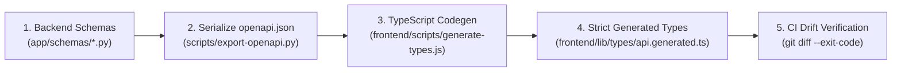

# SentinelFlow Contract Synchronization Skill

This skill enforces deterministic synchronization between backend Pydantic models (FastAPI OpenAPI schema) and frontend TypeScript types to prevent runtime contract drift.

## The Drift Prevention Pipeline



---

## Step-by-Step Contract Synchronization

### Step 1: Update Backend Pydantic Schemas
When introducing or changing an endpoint:
1. Define request and response schemas in `sentinelflow/backend/app/schemas/`.
2. Use strict Pydantic v2 types with explicit Field descriptions and validation bounds:
   ```python
   class TelecomClassifyRequest(BaseModel):
       sender: str = Field(..., description="E.164 phone number or alpha identifier")
       recipient: str = Field(..., description="E.164 destination phone number")
       message: str = Field(..., min_length=1, max_length=1600)
       carrier: str | None = None
       ip_address: str | None = None
   ```
3. Wire the schema to the FastAPI router in `sentinelflow/backend/app/api/`.

### Step 2: Regenerate `openapi.json`
Export the updated OpenAPI specification:
```bash
cd sentinelflow/backend
uv run python -c "
import json
from app.main import app
spec = app.openapi()
with open('openapi.json', 'w', encoding='utf-8') as f:
    json.dump(spec, f, indent=2)
print('Exported fresh openapi.json successfully')
"
```

### Step 3: Compile TypeScript Types
Run the automated code generator from `sentinelflow/frontend`:
```bash
cd sentinelflow/frontend
node scripts/generate-types.js
```
This updates `sentinelflow/frontend/lib/types/api.generated.ts`.

### Step 4: Verify Zero Drift
Check git diff to guarantee synchronization:
```bash
git diff --exit-code sentinelflow/backend/openapi.json sentinelflow/frontend/lib/types/api.generated.ts
```
**Verification Checkpoint**: If this command produces any output or exits non-zero, contracts are out of sync.

### Step 5: Update Frontend Consumer Code
Update consumers in:
- `sentinelflow/frontend/lib/api.ts`
- `sentinelflow/frontend/hooks/useSentinelAgent.ts`
- Components in `sentinelflow/frontend/components/`

Run the frontend test suite to ensure type safety:
```bash
cd sentinelflow/frontend
node --experimental-strip-types --test
```
