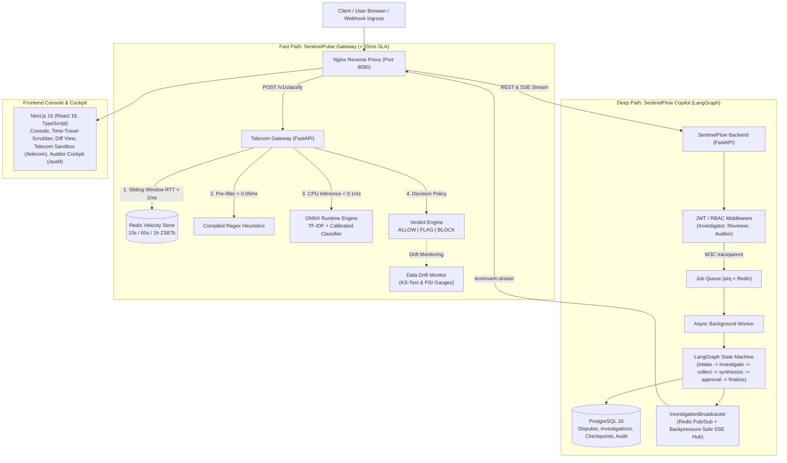

# SentinelFlow & SentinelPulse: Full System Context & Technical Architecture

> **Purpose:** This document is a complete, self-contained reference of the SentinelFlow & SentinelPulse platform. You can copy and paste this entire file into any AI model or chatbot for architectural reviews, code auditing, or system design questions.

---

## 1. Executive Overview & Mission

**SentinelFlow** is an enterprise-grade AI copilot and real-time intelligence gateway designed for mission-critical fintech and telecommunications trust-and-safety environments. It solves two complementary challenges:

1. **SentinelFlow (Asynchronous Complex Reasoning)**: An autonomous AI dispute investigation copilot built on **LangGraph**. It coordinates LLMs, deterministic risk engines, compliance rules, and native human-in-the-loop approval workflows with cryptographic auditability.
2. **SentinelPulse (Real-Time Synchronous Gateway)**: An ultra-low-latency traffic intelligence gateway that inspects high-throughput inbound messaging (SMS/events) for fraud, pumping attacks, and spam under a strict **$< 15\text{ ms}$** SLA using an optimized **ONNX Runtime** CPU model and **Redis sorted-set sliding-window velocity counters**.

### Architectural Tenet: 100% Free & Open-Source Stack
- **Zero Paid SaaS Dependencies**: No paid LangSmith, Datadog, Snyk, or commercial vendor lock-in.
- **Local/Self-Hosted Execution**: Docker Compose spins up PostgreSQL 16, Redis 7, Backend (FastAPI), Frontend (Next.js 16), Nginx, Prometheus, and Jaeger with one command.

---

## 2. High-Level System Architecture



---

## 3. Core Subsystems in Detail

### 3.1 LangGraph Multi-Agent Investigation State Machine
The investigation copilot manages autonomous research and synthesis over complex transaction disputes.

- **State Schema (`DisputeState`)**:
  - Strongly typed TypedDict utilizing explicit LangGraph reducers (`operator.add`, `add_messages`).
  - Fields include `evidence`, `analyzer_summaries`, `hypotheses`, `unresolved_questions`, `risk_assessment`, `compliance_findings`, and `timeline_events`.
- **Execution Flow**:
  1. `intake`: Ingests dispute narrative and metadata from PostgreSQL with pre-inference prompt injection guardrails.
  2. `investigate`: LLM agent formulates hypotheses and generates structured `ToolRequest` and `AnalyzerRequest` payloads while streaming live `reasoning_delta` SSE tokens via `ModelGateway.generate_structured`.
  3. `collect`: Concurrently dispatches evidence retrieval tools (`transactions`, `customer`, `device`, `merchant`) and deterministic analyzers (`fraud_pattern`, `device_fingerprint`) via `asyncio.gather` with `session_lock` serializing DB audit writes.
  4. `synthesize`: Deterministic risk scoring engine + synthesis LLM produces recommendation report (with live `reasoning_delta` streaming).
  5. `approval`: Native LangGraph `interrupt()`. Halts execution if risk exceeds policy threshold, persisting `approval_required` into `InvestigationRecord` via `persist_graph_state()`.
  6. `Human-in-the-Loop Revision Loop`: Reviewers can approve, deny, or select `request_revision` with steering guidance. Bounded to a maximum of 3 revision cycles (`MAX_REVISION_CYCLES = 3`) to prevent infinite execution loops.
  7. `finalize`: Closes dispute, writes terminal audit records, and updates database records.
- **Persistence & Distributed Tracing**:
  - Environment-aware checkpointer (`MemorySaver` in dev, `AsyncPostgresSaver` in prod) indexed by `thread_id`, coupled with `persist_graph_state()` so browser refreshes (`F5`) cold-hydrate mid-run evidence, hypotheses, and timeline events.
  - W3C `traceparent` / `tracestate` context is injected when enqueueing `arq` jobs in FastAPI and extracted by the worker (`run_investigation_job` / `run_resume_investigation_job`), linking HTTP ingress spans and background LangGraph node spans into a single distributed trace in Jaeger.

### 3.2 SentinelPulse High-Throughput Gateway
Designed for telecom and CPaaS messaging anti-abuse (e.g., 5,000+ RPS).

- **Inference Pipeline**:
  - Input: `{ sender, recipient, message, carrier, ip_address }`.
  - Step 1: Pre-compiled regex heuristics engine evaluates blocklists and common smishing patterns in $< 0.05\text{ ms}$.
  - Step 2: High-throughput Redis sliding-window velocity aggregation tracking messages sent in the last 10s, 60s, and 1h via pipelined `ZSET` commands in a single network roundtrip ($< 2\text{ ms}$).
  - Step 3: Lightweight classification model exported to **ONNX Runtime (CPU)** with AVX-512 optimization, running inferences in $< 0.1\text{ ms}$.
  - Composite Verdict: Evaluates combined risk signals to return `ALLOW`, `FLAG`, or `BLOCK` with execution latency tracking.
- **Fail-Open Circuit Breakers**:
  - If Redis or ONNX latencies breach 15ms or error rates exceed 2%, circuit breakers open.
  - Critical traffic (2FA/OTP tokens) is **Fail-Open** (`ALLOW`) to prevent user lockout; unverified international bulk traffic is **Fail-Closed** (`BLOCK`) or quarantined.

### 3.3 Cryptographic Audit Ledger & PII Governance
- **Tamper-Evident SHA-256 Ledger**:
  - Every agent action, prompt, reasoning trace, tool output, and human approval is cryptographically chained (`sequence_no`, `prev_hash`, `row_hash`).
  - Concurrent writes are serialized via per-investigation `asyncio.Lock` to eliminate race conditions and hash-tree forking.
- **Pre-Inference & Post-Inference PII Scrubbing**:
  - Pre-inference regex scrubber masks sensitive entity patterns (credit card PANs, SSNs, IBANs, phone numbers, emails, API tokens) *before* dispatching payloads to upstream model APIs.
  - Role-projected views: Standard users see masked data; authorized auditors can review redacted traces and verify hash-chain integrity.
- **Encrypted Raw Vault**:
  - Optional Fernet encryption for raw model payloads (`AuditArtifactRecord`), recording an audit event whenever raw data is decrypted.

### 3.4 MLOps & Real-Time Drift Monitoring
- **Data Drift (Kolmogorov-Smirnov Test)**:
  - Continuously evaluates incoming message length and token distributions against training baseline distributions ($p$-value threshold $0.05$).
- **Concept Drift (Population Stability Index - PSI)**:
  - Evaluates live model prediction score deciles against baseline distribution.
  - $\text{PSI} < 0.10$ (Stable), $0.10 \le \text{PSI} < 0.25$ (Moderate drift alert), $\text{PSI} \ge 0.25$ (Critical drift triggering retraining).
- **Telemetry**: Prometheus `/metrics` endpoint exports drift gauges (`telecom_drift_psi`, `telecom_drift_ks_pvalue`), request counts, fraud rate, and p50/p95/p99 latency histograms.

### 3.5 Full-Stack Frontend, Explainable AI Workbench & Auditor Cockpit
- **Next.js 16 App Router**: Strict TypeScript, 100% arrow function adoption, zero promise chains (full `try/catch` blocks), and route-level `loading.tsx` / `not-found.tsx` boundaries.
- **Real-Time Streaming & Cold Hydration**: Custom SSE parser with bounded exponential reconnect backoff (`500ms * 2^attempt`), live `reasoning_delta` token streaming, and full state cold-hydration on page refresh.
- **Explainable AI Workbench (`/disputes/[disputeId]`)**:
  - **Time-Travel State Scrubber (`TimeTravelScrubber.tsx`)**: Scrub through arbitrary historical event steps (`0..N-1`) in `<0.03ms` (`deriveConsoleStateAtStep`), with keyboard shortcuts (`[`, `]`, `L`) and deep-linkable URL query synchronization (`?step=`).
  - **Iteration & Revision Diff Inspector (`InvestigationDiffPanel.tsx`)**: Computes semantic diffs between agent iterations (`?diff=1`) with attribution badges (`[AI Investigator]`, `[Human Reviewer Steering]`, `[Deterministic Engine]`), hypothesis confidence shifts, and newly collected evidence IDs.
  - **Sticky Evidence Provenance Highlighting**: Clicking any citation pill in `AnalyzerPanel` or `AgentReasoningPanel` pins the citation (`?evidence=`), highlights the matching card in `EvidencePanel`, and smoothly scrolls it into view.
- **Telecom Intelligence Console (`/telecom`)**:
  - Live SSE traffic feed, throughput/latency percentile cards, KS/PSI drift gauges, and the interactive `TelecomClassifySandbox` (`POST /v1/classify`).
- **Auditor Dashboard (`/audit`)**:
  - Live cryptographic integrity verification badge (`verifyAuditIntegrity`).
  - Searchable, filterable audit event ledger table.
  - Side-by-side prompt and reasoning trace inspector.
  - Append-only auditor note modal (annotates errors without breaking the historical hash chain).
  - Development role switcher (`Investigator`, `Reviewer`, `Auditor`).

---

## 4. 7-Stage CI/CD Pipeline & Quality Gates

The project enforces a strict 7-stage automated verification pipeline:

| Stage | Name | Key Tools & Rules | Verification Metric |
| :---: | :--- | :--- | :--- |
| **1** | **Security & Supply Chain** | `gitleaks` (zero secret leaks), `trivy` (filesystem/container SCA), `pip-audit`, `pnpm audit`, `security_compliance_scan.py` | 11/11 controls passed (100% OWASP Top 10 & CWE compliance) |
| **2** | **Static Analysis & Guardrails** | `ruff check --select S`, `bandit`, `mypy app` (strict mode across 73 files), `eslint 10` + `sonarjs`, `check-rules.js` (AST guardrails) | 0 type errors, 0 linter warnings, 100% arrow function & try/catch compliance |
| **3** | **Deterministic Testing** | `pytest --cov=app --cov-fail-under=80`, `node --test`, Playwright E2E & visual pixel diff | **109 backend tests passed** (**86%+ coverage** across 4,949+ statements), **31 frontend unit tests passed** |
| **4** | **API Contract Drift Gate** | `openapi.json` $\leftrightarrow$ `generate-types.js` $\leftrightarrow$ `api.generated.ts` verified via `git diff --exit-code` | 0 contract drift |
| **5** | **AI Eval-Driven Development** | `app.evals.run` benchmark evaluating decision accuracy, evidence grounding, risk calibration, and zero PII leakage | 100% accuracy, 100% grounding, 100% PII safety |
| **6** | **Sandbox Container Smoke** | `docker compose up -d --build --wait`, live `/v1/classify` transaction smoke test, traffic simulator run, `down -v` | End-to-end container stack passes in clean isolated environment |
| **7** | **Automated PR Scorecards** | `$GITHUB_STEP_SUMMARY` publishing OWASP compliance matrix and AI evaluation benchmark results on PR runs | Verified on every commit and PR |

---

## 5. Technology Stack Summary

| Layer | Technologies |
| :--- | :--- |
| **Backend** | Python 3.12+, FastAPI, LangGraph, LangChain Core, Pydantic v2, SQLAlchemy 2.0 (asyncio), Alembic, arq |
| **Machine Learning** | ONNX Runtime (CPU AVX-512), Scikit-learn, SciPy (KS-test), NumPy |
| **Data Stores** | PostgreSQL 16 (pgvector-ready), Redis 7.2 (ZSET sliding windows, job queue, pub/sub) |
| **Frontend** | Next.js 16 (App Router), React 19, TypeScript 5.9, Tailwind CSS, Lucide Icons |
| **Security & Auditing**| Cryptographic SHA-256 hash chains, Fernet symmetric encryption, Gitleaks, Bandit, Trivy, SonarJS |
| **Telemetry & Observability**| OpenTelemetry (OTel SDK + W3C TraceContext), Prometheus metrics exporter, Jaeger distributed tracing |
| **Infrastructure** | Docker multi-stage builds, Docker Compose, Nginx reverse proxy |

---

## 6. Key File & Directory Map

```text
sentinelflow/
├── backend/
│   ├── app/
│   │   ├── agents/          # Investigator and Synthesizer LLM agents (with live astream delta callbacks)
│   │   ├── api/             # FastAPI routers (/disputes, /approvals, /telecom, /health, /evals)
│   │   ├── db/              # SQLAlchemy models (Dispute, Investigation, Audit, Artifact)
│   │   ├── evals/           # AI evaluation benchmark dataset, scorers, runner
│   │   ├── graph/           # LangGraph StateGraph, nodes, pure reducers, routing, prompts
│   │   ├── schemas/         # Pydantic v2 validation contracts
│   │   ├── services/        # Deterministic risk engine, audit ledger, broadcaster, model gateway, trace safety
│   │   ├── telecom/         # ONNX inference engine, Redis velocity store, drift monitor
│   │   ├── tools/           # Evidence collection tools (transactions, customer, device, merchant)
│   │   └── main.py          # FastAPI lifespan, middleware onion, CORS
│   └── pyproject.toml       # Dependencies, ruff, mypy, bandit, pytest-cov configurations
├── frontend/
│   ├── app/                 # Next.js 16 App Router pages (disputes/[id], telecom, audit, auth, loading/not-found)
│   ├── components/          # Console, TimeTravelScrubber, InvestigationDiffPanel, RiskPanel, AgentReasoningPanel, telecom/
│   ├── hooks/               # useSentinelAgent hook managing SSE stream, time-travel, and console state
│   ├── lib/                 # Typed API client, SSE stream parser, deterministic state derivation, generated API schemas
│   └── scripts/             # AST check-rules.js, generate-types.js
├── ops/
│   ├── nginx/default.conf   # Nginx reverse proxy, buffering disable for SSE, rate limiting
│   └── security_compliance_scan.py # 11/11 OWASP Top 10 & CWE automated scanner
├── OVERVIEW.md              # 7-stage CI/CD pipeline matrix, test coverage, and architectural FAQ
├── SYSTEM_DESIGN.md         # Telecom ML gateway 1k -> 100k RPS scaling, ONNX vs LLM trade-offs
├── README.md                # Project setup, local development, and zero-cost stack guidelines
└── docker-compose.yml       # Local stack orchestration (PostgreSQL, Redis, Backend, Frontend, Nginx)
```

---

## 7. Common Technical & Interview Inquiries

### Q: Why ONNX Runtime on CPU instead of a larger Transformer on GPU for the gateway?
At gateway ingress, telecom SLAs mandate end-to-end response times under 15ms. An 8-core CPU node serves $> 12,000$ ONNX inferences/second with $p99 < 0.1\text{ ms}$ at \$0.08 per million messages with zero GPU infrastructure complexity. A 12-layer Transformer on GPU achieves ~150 RPS with $p99 > 85\text{ ms}$ at \$14.50 per million messages, breaching latency SLAs and increasing operational cost by 180x.

### Q: How is state maintained safely across human approval pauses in LangGraph?
When the risk engine flags a dispute for human oversight, LangGraph executes `interrupt()`. The state is serialized and persisted to PostgreSQL by `AsyncPostgresSaver` keyed by `thread_id`, and `persist_graph_state()` writes the mid-run snapshot and `approval_required` timeline event to `InvestigationRecord`. The HTTP worker returns immediately. When a reviewer submits their decision via `POST /investigations/{id}/resume`, the graph resumes from its exact checkpoint using `Command(resume=...)`.

### Q: How do you prevent tampering in AI audit trails?
Every audit record includes a sequence number, timestamp, actor ID, and payload hash linked to the previous record's hash:
$$\text{RowHash} = \text{SHA256}(\text{Seq} \parallel \text{PrevHash} \parallel \text{EventName} \parallel \text{ActorRole} \parallel \text{PayloadJSON})$$
Modifying any row invalidates all subsequent hashes. An auditor verification endpoint validates the entire chain from genesis ($0$) to head in real time.
