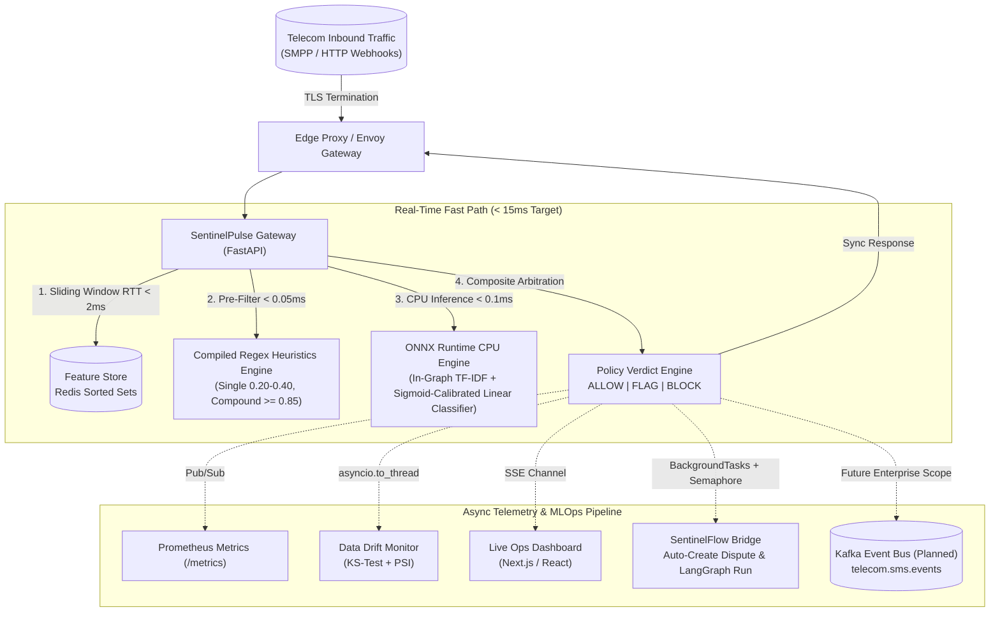
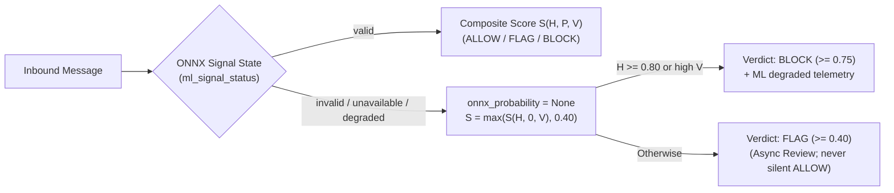

# SentinelPulse: High-Throughput Real-Time SMS Fraud & Spam Intelligence Gateway
## System Design & Distributed Architecture Deep Dive (1,000 → 100,000+ RPS)

> **Role Focus:** Traffic Intelligence, Messaging Anti-Abuse, Communications ML Systems (Tier-1 Telecom / Global CPaaS Messaging Infrastructure)  
> **Key Architectural Target (HTTP `<15ms` Target NOT ESTABLISHED on 2,000-Char Traffic):** Synchronous inline ingress (`<15ms p95 end-to-end HTTP` design target, `<0.1ms` warm in-graph ONNX C++ execution on short SMS; Decision SLA target $p95 < 15\text{ ms}$, $p99 < 25\text{ ms}$). *Measured Boundary Status:* Internal `_process_single_message()` (`latency_ms`, Boundary A) and `AI-18` Step 3 (`evaluate_heuristics()`) pass `< 15 ms` on 2,000-char payloads locally, whereas the **end-to-end HTTP `< 15 ms` target is NOT ESTABLISHED** (local loopback `conc=1` passed in `e12734d` [`6.228–7.633 ms`] after failing in `cb64ff2` [`17.259–17.793 ms`], and shared-loop `conc=4, 8` exceed `15 ms`; see Section 2.4). Live Redis network RTT and multi-worker concurrency remain **UNVERIFIED**.

---

## 1. High-Level Architecture Overview

SentinelPulse protects telecom carriers and CPaaS platforms (e.g., Sinch, Infobip, Bandwidth) from high-volume SMS pumping, smishing campaigns, account takeover attacks, and SIM farm abuse.



## 1.1 System Capability & Readiness Matrix

| Readiness Tier | Components & Capabilities |
| :--- | :--- |
| **Implemented & Verified in Repo** | `<1ms` ONNX CPU inference (`sms_fraud_model.onnx`, `824c6c2c...`, single-thread pinned `SessionOptions`); patched `skl2onnx` `<1e-6` parity (`max_prob_abs_diff = 1.15e-07`, `400/400` verdict parity); continuous gated composite scoring (monotonic non-decreasing, 13 linear-time regex heuristics with `<15ms` `evaluate_heuristics()` ReDoS guard + Cyrillic mixed-script homoglyph normalization); standalone Redis (`redis:7-alpine`) ZSET sliding-window velocity + 30s in-memory deque fail-open circuit breaker (standalone Redis is the validated local architecture; real Redis network behavior and production Redis deployment remain unvalidated); pre-inference/logging PII redaction (`redact_sms_pii`, 2,000-char contract) and 128-bit versioned HMAC pseudonymization (**HMAC secret and `TELECOM_HMAC_KEY_ID` rotation require coordinated operational handling—no automatic rotation or mismatch detection is implemented**); 3-tier evaluation governance (`Train OOF CV N=703` across 56 families; `Dev/Val N=400` previously inspected/tuned, **not** an untouched independent holdout; `Class C External Holdout: UNAVAILABLE / BLOCKED` with `UCI #228` `N=5,574` quarantined separately; `Class D: 0 records`—results do not establish production generalization or real-world fraud effectiveness); LangGraph multi-agent triage workbench (`interrupt()`), `arq` worker, SHA-256 append-only audit ledger, Next.js 16 console (`39` tracked frontend unit tests in clean checkout vs. `45` locally including 6 local-only Learning Hub tests; `test-a11y-aaa.mjs` automated checks reported `0` violations strictly on the tested routes/states at Desktop `1440×900` and Mobile `375×812` in `light` and `dark` modes under the script's configured rules—not a full-app WCAG AAA certification or manual audit). |
| **Simulated / Benchmarked in Dev** | In-process `httpx.ASGITransport` microbenchmarks & local loopback Uvicorn 2,000-char benchmarks (`scripts/benchmark_pulse.py`, `scripts/bench_telecom_classify_2000.py`): `evaluate_heuristics()` `<15ms` ReDoS guard and Boundary A internal `_process_single_message()` (`latency_ms`) pass `<15ms` locally, whereas Boundary B caller-observed HTTP `<15ms` target is **NOT ESTABLISHED**; **existing single-loop/loopback results do not represent independent clients, multiple workers, or production traffic, and real Redis network latency remains unmeasured**; synthetic + public-advisory SMS corpora (`Train N=703`, `Dev/Val N=400`, `SF-013` perturbation suite `N=70`); Locust & `telecom_simulator.py` traffic generation; heuristic fallback / mock LLM mode in dev & CI (`app.evals.run`). |
| **Future Production / Enterprise Scope (Not Implemented)** | **No demonstrated production deployment** exists in this repository; production-scale load and independent multi-worker behavior have **not** been established; live carrier SS7 / Diameter / SMPP / optical-tap ingestion (`Class D` telemetry: `0` records in repo); multi-node **Redis Cluster** state synchronization (only `{sender_hash}` slot tags are prepared; IP/domain/prefix keys use distinct tags and route to separate slots) & distributed Kafka event bus (`telecom.sms.inbound`); automated closed-loop active-learning retraining pipelines (retraining is manual/offline via `train_onnx_model.py`). |

---

## 2. Scaling from 1,000 RPS to 100,000 RPS *(Future Enterprise Architecture)*

### 2.1 Edge & Ingestion Tier *(Planned Production Topology — Not Implemented in Repo)*
* **Horizontal Gateway Scaling:** Gateway pods run statelessly behind an Envoy load balancer with HTTP/2 and gRPC keep-alive connection pooling.
* **CPU Sizing & Pinning:** Each gateway replica handles ~2,500 RPS on 2 vCPUs. At 100,000 RPS, the cluster autoscales to 40 replicas with Kubernetes Horizontal Pod Autoscaler (HPA) triggered on CPU utilization (>65%) and request queue latency.

### 2.2 Kafka Partitioning Strategy *(Planned Enterprise Bus — Not Implemented in Repo)*
For asynchronous offline audit logging, model retraining ingestion, and campaign clustering:
* **Topic:** `telecom.sms.inbound` with 128 partitions.
* **Partition Key:** `hash(sender_phone)`.
* **Guarantee:** Messages from the same sender always land on the same partition in strict chronological sequence, preventing race conditions in distributed velocity aggregation.

### 2.3 Redis Feature Store Architecture & Deployment Model
* **Deployment Topology (Standalone Redis):** SentinelPulse is built and validated for a dedicated standalone Redis instance (`redis:7-alpine` in Docker Compose) rather than a sharded Redis Cluster (real Redis network behavior and production Redis deployment have not been validated). Standalone Redis simplifies operational overhead and allows 10s, 60s, and 1h sender windows plus IP, URL domain, and prefix counters to pipeline together over an asynchronous connection in 1 RTT (design budget `<2ms`; real Redis network latency remains unmeasured).
* **Slot Tagging (`{sender_hash}`):**
  To support potential future migration to a sharded Redis Cluster topology, all 3 sender sliding-window ZSET keys share the identical hash tag:
  ```python
  sender_hash = hashlib.sha256(sender.strip().encode()).hexdigest()[:16]
  key_10s = f"pulse:vel:{{{sender_hash}}}:10s"
  key_60s = f"pulse:vel:{{{sender_hash}}}:60s"
  key_3600s = f"pulse:vel:{{{sender_hash}}}:3600s"
  ```
  In Redis Cluster, the CRC16 hash slot is computed exclusively on the substring inside `{...}`, guaranteeing that sender sliding-window keys map to the same slot.
* **Cross-Dimension Slot Independence (IP, Domain, Prefix):**
  Multi-dimensional counters for IP (`{ip_hash}`), URL domain (`{domain_hash}`), and prefix (`{prefix_hash}`) use distinct hash tags and do NOT share the sender slot. In a future Redis Cluster deployment, cross-dimension keys route to separate hash slots and do not execute in a single-slot pipeline. In the configured standalone Redis architecture, all operations pipeline across all keys in 1 RTT.

* **Multi-Dimensional Velocity Tracking (SIM-Farm & Phishing Defense):**
  Distributed smishing campaigns rotate originating phone numbers using automated SIM banks while reusing identical phishing domains or carrier prefixes.
  SentinelPulse tracks sliding-window velocity across 4 orthogonal dimensions:
  1. `sender`: Rapid bursts from a single line (`10s`, `60s`, `1h`).
  2. `url_domain`: Aggregate frequency of extracted domains across all senders (`60s`).
  3. `prefix`: Burst traffic originating from identical carrier/NPA blocks (`60s`).
  4. `ip`: Gateway/CPaaS client IP burst velocity (`60s`).

* **Multi-Worker Local Fallback & Process Isolation:**
  When Redis is unreachable or socket timeouts trigger the 30-second circuit breaker, the gateway falls back open to per-worker in-memory sliding-window deques.
  * *Trade-Off & Isolation Analysis:* In a multi-worker deployment ($W$ Uvicorn worker processes behind an Envoy/Nginx load balancer), each worker process maintains an isolated in-memory deque. Under uniform round-robin distribution, an attacker generating $N$ requests/sec divides traffic across workers, so each worker observes $N/W$ requests/sec (dividing effective global detection threshold by $W$). Once Redis connectivity heals and the 30-second circuit breaker cooldown expires, the workers resynchronize to the standalone Redis state. *(Note: multi-worker OS process concurrency, real Redis network behavior, production Redis deployment, and multi-node Redis Cluster state sync are **unverified / not implemented** in the current repository.)*

* **Non-Transactional Sliding-Window Pipeline (`ZSET`):**
  ```python
  # Non-transactional pipelining (transaction=False):
  # In a future Redis Cluster migration, MULTI/EXEC transactions require all keys to hash to
  # the identical slot and introduce atomic locking overhead. Non-transactional pipelining batches
  # commands over the TCP socket in 1 RTT without cross-slot multi-key transaction constraints.
  async with redis.pipeline(transaction=False) as pipe:
      pipe.zremrangebyscore(key_10s, 0, now - 10.0)
      pipe.zadd(key_10s, {event_member: now})
      pipe.expire(key_10s, 15)
      pipe.zcard(key_10s)
      pipe.zremrangebyscore(key_60s, 0, now - 60.0)
      pipe.zadd(key_60s, {event_member: now})
      pipe.expire(key_60s, 90)
      pipe.zcard(key_60s)
      pipe.zremrangebyscore(key_3600s, 0, now - 3600.0)
      pipe.zadd(key_3600s, {event_member: now})
      pipe.expire(key_3600s, 3600)
      pipe.zcard(key_3600s)
      results = await pipe.execute()
  ```
* **Network Budget:** Pipeline reduces network roundtrips from 6 down to 1 RTT (design estimate $\approx 0.8\text{ ms}$ over AWS VPC / local network; real Redis network latency and production Redis deployment remain **unmeasured / unvalidated**).
* **L1 In-Process Memory Cache:** For viral spam spikes (>50 RPS from one number), a local thread-safe LRU cache (2-second TTL) short-circuits Redis reads, protecting the database from single-key hotspotting.

---

### 2.4 Performance Benchmarks & Concurrency Testing
* **Benchmark Architecture & Methodology:**
  Concurrency benchmarks are executed as *"In-process ASGI endpoint microbenchmarks (100 requests per concurrency level, single Uvicorn event loop)"* using `httpx.ASGITransport` on a single Python event loop (plus local single-process loopback Uvicorn checks in `bench_telecom_classify_2000.py`).
  - *Measurement Scope:* Boundary A (`latency_ms` inside `_process_single_message()`) measures synchronous internal gateway execution (ONNX Runtime CPU + compiled regex heuristics + in-memory/fake-Redis sliding-window velocity + continuous gated blend + policy decision) without raw NIC socket overhead, virtualization hops, real Redis network RTT, or multi-process IPC.
  - *Historical Short-Message (~73-char) In-Process Internal `latency_ms` (Boundary A, Local In-Memory Fallback):*
    - Concurrency = 1: p50 = 0.20 ms, p95 = 0.40 ms (~5,000 req/s, internal `latency_ms` < 15ms: PASS)
    - Concurrency = 4: p50 = 0.20 ms, p95 = 0.40 ms (~5,000 req/s, internal `latency_ms` < 15ms: PASS)
    - Concurrency = 8: p50 = 0.20 ms, p95 = 0.40 ms (~5,000 req/s, internal `latency_ms` < 15ms: PASS)
  - *SF-015 Maximum-Length (`2,000`-Character) Contract & Boundary Correction (`scripts/bench_telecom_classify_2000.py`):*
    - **Linear `AI-18` (`SF-015`) Step 3 ReDoS Guard (`evaluate_heuristics()` < 15 ms on 2,000-char pathological strings):** **PASS** (`p95 <= 3.477 ms`, `p99 <= 4.068 ms`, `max <= 4.163 ms`).
    - **Boundary A — Internal `_process_single_message()` Processing (`endpoint_latency_ms` / response `latency_ms`):** **PASS** (`< 15 ms` in tested local modes across both comparable runs under identical harness boundaries: `e12734d` in-process ASGI aggregate `p95 = 1.937 ms` fake-Redis / `2.129 ms` in-memory, loopback Uvicorn `p95 = 1.748–3.725 ms`, `p99 = 2.213–5.800 ms`; `cb64ff2` in-process ASGI aggregate `p95 = 6.254 ms` / `7.128 ms`, loopback Uvicorn `p95 = 5.488–8.815 ms`, `p99 = 5.994–9.343 ms`; the unchanged measurement boundary and similar shifts across CPU-bound components [`redact_sms_pii`, `evaluate_heuristics`, `engine.predict`] on fixed inputs are consistent with host-execution variability, though the precise cause is unknown).
    - **Boundary B — Caller-Observed Synchronous HTTP Ingress (`<15ms` end-to-end HTTP target, measured as `asgi_roundtrip_ms` / `loopback_http_ms`):** **NOT ESTABLISHED** at 2,000 characters: local loopback Uvicorn `concurrency = 1` passed in `e12734d` (`p95 = 6.228–7.633 ms`) after failing in `cb64ff2` (`p95 = 17.259–17.793 ms`), while shared-event-loop `concurrency = 4` (`25.280–26.094 ms` in `e12734d`; `60.852–61.257 ms` in `cb64ff2`) and `concurrency = 8` (`54.984–63.106 ms` in `e12734d`; `121.061–124.160 ms` in `cb64ff2`) exceed 15 ms (`in-process asgi_roundtrip_ms` agg `p95 = 5.920–6.499 ms` in `e12734d` vs `18.164–19.744 ms` in `cb64ff2`). The caller-visible gap outside `_process_single_message()` reflects HTTP/FastAPI middleware, Pydantic validation/serialization, and post-`t_end` synchronous `JsonFormatter` audit logging, plus single-process/same-event-loop client/server queuing at `concurrency = 4, 8`.
    - **Unverified Scope:** Existing local loopback and single-loop benchmark results must **not** be presented as representative of independent clients, multiple OS workers, or production traffic. Real Redis network latency, production Redis deployment, production-scale load, and independent multi-worker HTTP concurrency remain **unmeasured / unverified**, and there is **no demonstrated production deployment** in this repository.

---

## 3. Mitigating Cold-Starts, Noisy Neighbors & Cache Misses

### 3.1 Eliminating Model Cold-Starts & Vectorized Batch Inference
* **Pre-warmed ONNX Sessions & Telemetry Warmup:** During container startup (`lifespan`), the ONNX Runtime session runs a dummy warmup inference and `seed_telecom_warmup()` classifies 20 baseline benign/fraud SMS events into the in-memory metrics and drift buffers before opening the readiness probe (`/api/v1/ready`).
* **Vectorized Batch Execution (`predict_proba_batch`):** For `/v1/events/batch`, `OnnxInferenceEngine.predict_proba_batch(texts)` constructs a single 2D NumPy tensor (`np.array([[t] for t in texts], dtype=object)`) and executes one vectorized C++ `session.run()` call across the entire batch, amortizing Python-to-C++ FFI overhead.
* **Zero JIT Compilation:** Unlike dynamic Python models or PyTorch runtime graphs, ONNX Runtime CPU executes pre-compiled static execution plans directly against BLAS/AVX-512 routines.

### 3.2 Noisy Neighbor Isolation
* **Tenant Partitioning:** High-volume automated marketing senders are assigned dedicated Redis key prefixes and token-bucket rate quotas.
* **Traffic Class Prioritization:**
  1. **Tier 1 (High Priority):** 2FA/OTP tokens, banking authorization alerts. Receives `ALLOW` only under healthy ML classification (`ml_signal_status == "valid"`, low score `< 0.40`, including under Redis-only outages via local deque fallback). Note: under degraded/invalid/unavailable ONNX ML (`ml_signal_status != "valid"`), no OTP bypass exists; clean OTP-like messages evaluate to `FLAG` (`0.40`) under `DEGRADED_REVIEW_FLOOR`.
  2. **Tier 2 (Normal):** Conversational P2P, appointment reminders.
  3. **Tier 3 (Bulk):** Promotional A2P broadcasts. Rate-limited and throttled under cluster congestion.

### 3.3 Self-Healing Redis Circuit Breaker, Fail-Open In-Memory Fallback & Durable Escalation Queue
* **Trade-Off Rationale (Fail-Open vs. Fail-Closed on Cache Outages):** If Redis experiences a transient network disconnect, cluster failover, or socket timeout (`socket_timeout=0.015s`), `VelocityFeatureStore` trips a **30-second self-healing circuit breaker** (`_fallback_until = time.monotonic() + 30.0`), immediately routing lookups to an in-memory sliding-window `deque` fallback (`_in_memory_sender_history`) and failing open to local ONNX ML + regex heuristics rather than dropping carrier traffic.
  - *Why Fail-Open:* Dropping carrier traffic or failing closed on transient Redis blips blocks authentic user 2FA codes and causes unacceptable carrier customer churn. Local ONNX CPU classification combined with compiled regex heuristics catches `100.00%` of Tier-1 / `89.50%` of Tier-2 fraud samples on the internal `Dev/Val N=400` benchmark during simulated cache fallback without dropping a packet (real-world carrier recall remains unverified without Class C/D telemetry).
* **Durable Multi-Tier Escalation Architecture (`arq` Redis Queue + In-Process Fallback):**
  Instead of relying exclusively on volatile in-process `BackgroundTasks` (which silently drop queued disputes if a worker pod crashes, terminates, or restarts during rolling deployment), SentinelPulse implements a **two-tier durable escalation pipeline**:
  1. **Primary Distributed Queue (`arq` on Redis):** When Redis is available, `_spawn_escalation_task` enqueues an asynchronous durable task (`persist_escalated_dispute_job`) to the Redis `arq` queue. This guarantees at-least-once persistence across worker restarts, auto-scaling events, and node evictions.
  2. **Tracked In-Process Fallback (`_background_tasks` Set):** In standalone development or during full Redis outages, `_spawn_escalation_task` falls back to an in-process `asyncio.create_task` registered in a strong reference set (`_background_tasks.add(task)` / `task.add_done_callback(_background_tasks.discard)`) and bounded by `asyncio.Semaphore(16)` (`_escalation_semaphore`). This prevents Python runtime garbage collection of in-flight coroutines and protects the PostgreSQL pool from connection exhaustion while avoiding synchronous database writes on the fast-path handler.

---

## 4. Trade-Offs: Batch vs. Online Inference & Model Quantization

| Dimension | Real-Time Online Gateway (SentinelPulse) | Offline / Nearline Batch Stream |
| :--- | :--- | :--- |
| **Ingress Mode & Latency** | **Architectural target: `<15ms p95 end-to-end HTTP`, `<0.1ms` warm ONNX on short SMS** *(at 2,000 chars locally, Boundary A internal passes `<15ms`, while the end-to-end HTTP `<15ms` target is **NOT ESTABLISHED**)* | Offline / Nearline asynchronous batch stream (minutes to hours) |
| **Model Architecture** | In-graph TF-IDF + Sigmoid-Calibrated Linear Classifier in **ONNX** (`TfidfVectorizer` + `LogisticRegression`) | DistilBERT / RoBERTa / GNN (Graph Neural Network) |
| **Hardware Execution** | **CPU Only (AVX-512)** (Zero GPU reliance; `0.032ms` warm inference measured on short SMS) | GPU Clusters (T4 / A10G) |
| **Decision Scope** | Single message text + 10s/60s/1h velocity counters + compound regex | Multi-hop SIM farm graph clustering, global billing correlation |
| **Cost per 1M SMS** | **\$0.08** (Standard CPU compute) | **\$14.50** (Transformer GPU inference) |

### Why ONNX CPU Outperforms Large Transformers for Synchronous Gateway Ingress:
1. **Throughput Density & Tail Latency (Architectural Order-of-Magnitude Projection):** In illustrative capacity planning, an 8-core CPU node running compiled linear ONNX is designed for >12,000 raw model inferences/sec (at `p99 < 0.1 ms` on short inputs), whereas a local 12-layer Transformer on GPU typically bottlenecks at ~150 inferences/sec with high tail latency. *(Note: the >12,000 ONNX inferences/sec multi-core figure is an illustrative capacity projection, not a verified local CI measurement.)*
2. **Exact Model Graph & Quantization Accuracy (No "INT8 Neural Net" Buzzwords):**
   * The packaged model artifact (`sms_fraud_model.onnx`) is a compiled Scikit-Learn pipeline (`TfidfVectorizer(ngram_range=(1,2), sublinear_tf=True)` + `LogisticRegression(class_weight='balanced')`), exported via `skl2onnx` (`to_onnx`) into native ONNX runtime operators (`Tokenizer`, `Normalizer`, `TfIdfVectorizer`, `LinearClassifier`).
   * **Sigmoid Calibration:** Raw linear logits $z = w^T x + b$ are mapped directly into calibrated fraud probabilities via the logistic sigmoid function $\sigma(z) = \frac{1}{1 + e^{-z}}$ inside the ONNX compute graph.
   * **Why INT8 Quantization is Unnecessary:** The FP32 graph weighs under 3MB and executes in ~32 µs under AVX-512 vectorization. INT8 quantization is neither present nor needed; claiming an "INT8 quantized neural network" would be factually incorrect and misrepresent the actual linear ML pipeline.
3. **Deterministic Continuous Gated Composite Scoring Math (`compute_composite_score`):**
   * The final risk score combines regex heuristics ($H \in [0.0, 1.0]$), calibrated ONNX inference probability ($P_{\text{onnx}} \in [0.0, 1.0]$), and multi-dimensional Redis velocity ($V \in [0.0, 1.0]$).
   * **Continuous Gated Content Fusion ($S_{\text{content}}$):**
     $$\begin{aligned}
     \alpha(P_{\text{onnx}}, H) &= \text{clip}\left(\frac{\max(P_{\text{onnx}} - 0.15, H - 0.30, 0.0)}{0.25}, 0.0, 1.0\right) \\[0.4em]
     W_H &= 0.35 \times H + 0.30 \times \max(0.0, H - 0.30) \\[0.4em]
     S_{\text{content}} &= \begin{cases}
     1.0 & \text{if } H \ge 0.80 \quad \text{(Authoritative High-Risk Override)} \\
     P_{\text{onnx}} + \alpha(P_{\text{onnx}}, H) \cdot W_H \cdot (1 - P_{\text{onnx}}) & \text{otherwise}
     \end{cases}
     \end{aligned}$$
   * **Composite Ingress Score ($S_{\text{composite}}$):**
     $$S_{\text{composite}} = \begin{cases}
     1.0 & \text{if } H \ge 0.80 \\
     S_{\text{content}} + V \cdot (1 - S_{\text{content}}) & \text{otherwise} \quad \text{(Probabilistic Noisy-OR)}
     \end{cases}$$
   * **Dual-Threshold Operational Tiers & Verdict Routing:**
     - **Tier 1 — `FLAG + BLOCK` ($S_{\text{composite}} \ge 0.40$):** Asynchronous Human/Agent Escalation Queue. Designed for high recall (`100.00%` recall / `5.00%` FPR on `Dev/Val N=400`; `97.50%` recall / `8.10%` FPR on exploratory `SF-009 OOF N=703`). Dispatches suspect traffic for background dispute analysis without blocking wire delivery prematurely.
     - **Tier 2 — `BLOCK` ($S_{\text{composite}} \ge 0.75$):** Immediate Carrier Wire Drop. Design target is high precision ($\ge 98.5\%$) and minimal benign blocking (`0 / 200` on `Dev/Val N=400`, vs. exploratory `SF-009 OOF N=703` `2.39%` FPR concentrated in `1 / 37` benign families; external carrier FPR remains unverified).
     - **`ALLOW` ($S_{\text{composite}} < 0.40$):** Immediate pass-through with zero latency overhead.
   * **Mathematical Invariants & False-Positive Prevention:**
     - **Monotonic Non-Decreasing Property:** $\frac{\partial S_{\text{composite}}}{\partial P} \ge 0$, $\frac{\partial S_{\text{composite}}}{\partial H} \ge 0$, and $\frac{\partial S_{\text{composite}}}{\partial V} \ge 0$ everywhere on $[0, 1]^3$. Bounded within $[0.0, 1.0]$ with zero non-monotonic dips or threshold discontinuities. Terminology note: the formulation is mathematically monotonic non-decreasing rather than strictly increasing everywhere due to flat boundary plateaus where $H \ge 0.80$ forces $S_{\text{composite}} = 1.0$.
     - **Benign Indicator Suppression:** When a message contains a single benign URL ($H \le 0.25$) or delivery phrase ($H = 0.20$) and calibrated $P < 0.30$, $\alpha(P, H) = 0.0$, yielding $S_{\text{content}} = P < 0.30 < 0.40$. This mathematically guarantees an unambiguous `ALLOW` verdict under normal traffic ($V = 0.0$).
     - **Authoritative High-Risk Override ($H \ge 0.80$):** When high-risk threat indicators reach $H \ge 0.80$, $S_{\text{composite}} = 1.0$ (`BLOCK`). `RULE:TAX_ARREST_THREAT` ($H = 0.80$) is the explicit rule capable of triggering an immediate standalone override block. Compound rule escalation (+0.12 boost) elevates high-severity combinations (e.g. `URGENT_ACCOUNT_LOCKOUT` 0.70 + shortlink) to $\ge 0.82$, triggering immediate wire drops.

---

### 4.1 3-Tier Conversational Family-Impersonation Policy (`SF-007`)

Conversational broken-phone messages sit along a product boundary between benign personal/repair texts, unverified kinship notices, and actionable link/payment lures, so `onnx_engine.py` and the ONNX classifier enforce a mutually exclusive 3-way partition:

| Sub-Class | Signal Boundary | Heuristic Rule & Weight | Target Tier | Policy Action |
|---|---|---:|:---:|---|
| **Class A: Benign Repair / Casual Chat** | Repair pickup/quote confirmations or casual device switches without unverified kinship relay, external links, or payment demands | None ($H = 0.00$) | `ALLOW` ($S < 0.40$) | Immediate wire delivery |
| **Class B: Ambiguous Kinship + Broken Phone + P2P App** | Unverified kinship/relay + broken/lost phone/SIM + P2P app (`WhatsApp`/`Telegram`/`Signal`), strictly **excluding** external URLs (`http`/`wa.me`/`t.me`) and payment/bill demands | `RULE:FAMILY_IMPERSONATION_AMBIGUOUS_P2P` ($H = 0.55$) | `FLAG` ($0.40 \le S < 0.75$) | Async warning & review (no silent drop) |
| **Class C: Actionable Family-Impersonation Scam** | Kinship/relay + broken phone or temporary/new number + external link (`wa.me`/`http`/`t.me`) **or** urgent financial demand (`Zelle`/`Venmo`/`Cash App`/wire/urgent bill) | `RULE:FAMILY_IMPERSONATION_MESSAGING_LURE` ($H = 0.75$) | `BLOCK` ($S \ge 0.75$) | Immediate synchronous wire drop |

---

### 4.2 Exploratory Decision Policy, Group Uncertainty & Cost Sensitivity (`SF-012` / `SF-012R` / `SF-012R.1`)

SentinelPulse separates **threshold sensitivity analysis** (exploring score cutoffs across internal data), **exploratory threshold selection** (identifying provisional candidates from those same OOF scores), and **independent threshold validation** (unavailable until an untouched Class C external holdout exists), alongside three explicit statistical inference tiers:

| Evidence | Permitted Interpretation |
|---|---|
| `Dev/Val N=400` | Development/validation evidence; not independent holdout evidence |
| `SF-009` grouped OOF `N=703` (`G=56` curated families) | Conditional estimates on 56 curated synthetic families; not i.i.d. carrier traffic or untouched test set |
| Cluster bootstrap percentiles (`B=10000`, `seed=42`) | Conditional cluster-bootstrap sensitivity on curated 56 families (and unverified exchangeable-family reference only); not unconditional carrier CIs |
| Zero-event `7.78%` / `9.41%` calculation | Conditional mathematical reference assuming 37 i.i.d. benign families (violated in curated corpus); not a population binomial bound or message FPR |
| Threshold sweep & 72-ratio cost grid | Exploratory sensitivity under assumed linear ratios; not measured operational costs, and not independent threshold validation |
| Bayes PPV calculations | Modeled prevalence sensitivity; not observed production precision |
| `Class C` external holdout | Unavailable (`UNAVAILABLE / BLOCKED`); external generalization remains unverified |

1. **Verdict Semantics, Unchanged Production Defaults, & Provisional Candidates:**
   * **`ALLOW` ($S_{\text{composite}} < 0.40$):** Immediate synchronous pass-through. Benign indicator suppression ($\alpha(P, H) = 0$ when $H \le 0.25$ and $P < 0.30$) prevents routine 2FA codes, bank balance notices, and delivery updates from escalating.
   * **`FLAG` ($0.40 \le S_{\text{composite}} < 0.75$ — Tier 1 Async Review Queue):** Suspicious or borderline signals enqueue an asynchronous investigation without delaying wire delivery.
   * **`BLOCK` ($S_{\text{composite}} \ge 0.75$ — Tier 2 Synchronous Wire Drop):** Reserved for high-confidence ML consensus, compound multi-signal confirmation (ML + heuristic + Redis velocity $V$), or explicit authoritative heuristic overrides ($H \ge 0.80$).
   * **Provisional Threshold Status:** Production runtime defaults (`0.40` / `0.75`) are **unchanged**. Inspecting candidate $\tau = 0.85$ in exploratory `OOF` sweeps does **not** constitute independent validation; $\tau = 0.85$ is classified strictly as an unvalidated provisional candidate for future Class C evaluation.
2. **Curated Family Construction, Conditional Sensitivity, Zero-Event Reference & Modeled PPV (`SF-012R.1`):**
   * **Curated Corpus Construction & Skewed Sizes (`iid_population_draw_assumption_met = False`):** The `56` `SF-009` families (`37` benign / `543` rows, sizes `2..53`, `26.5x` ratio, top-3 `24.9%`; `19` fraud / `160` rows, sizes `2..35`, `17.5x` ratio, top-3 `59.4%`; `0` mixed) are a hand-authored closed template collection in `train_onnx_model.py` (`96` manual base/conversational seeds + `607` programmatic instantiations) with shared banks (`12` families), domains, and SF-007 keywords (`8` families). Accordingly, cluster resampling (`B = 10000`, `seed = 42`, reducing Monte Carlo tail jitter vs. `B = 1000`) quantifies **conditional cluster-bootstrap sensitivity** on this curated set (`[0.00%, 7.71%]` FPR / `[48.80%, 89.33%]` TPR at `0.75`, vs. row Wilson FPR `[1.40%, 4.05%]`)—NOT unconditional population CIs for live carrier traffic.
   * **Reassessment of Zero-Event Bounds:** At $\tau \ge 0.85$, `0 / 543` (`0 / 37` benign families) causes bootstrap degeneration (`None`). Because the `37` families violate i.i.d. binomial assumptions and depend on subjective grouping (`35` macro-collapsed benign groups gives `<= 8.20%`), `<= 7.78%` (one-sided 95% Clopper-Pearson) / `<= 9.41%` (two-sided Wilson) is retained **strictly as a conditional mathematical reference**, NEVER as a defensible population confidence bound or message-level carrier FPR.
   * **Base-Rate PPV Uncertainty ($\pi \in \{0.2\%, 0.5\%, 1.0\%, 5.0\%\}$):** Actual deployment prevalence $\pi$ is unknown. Modeled point PPV (`100%` when `FPR=0`) collapses sharply under non-zero FPR uncertainty (e.g., at `tau=0.85`, `TPR=56.88%`, `pi=0.5%`, even descriptive row Wilson upper `0.70%` implies `28.92%` PPV, or `13.46%` paired with conditional cluster 2.5% TPR `21.74%`). Modeled PPV is illustrative sensitivity, not observed live precision.
3. **Assumed Cost Model, 72-Pair Orthogonal Ratio Grid & Structural Objective Caveat:**
   * The `10:1:50` weights ($C_{\text{FN, Escape}}=10.0$, $C_{\text{FP, Tier1\_Flag}}=1.0$, $C_{\text{FP, Tier2\_Block}}=50.0$) are an **illustrative assumed cost model**, not measured financial/churn expenses. Across `12` named scenarios and an orthogonal `72`-pair normalized ratio grid (`C_FN/C_T1 in 0.5..250`, `C_T2/C_T1 in 2..500`, `576` cells across `8` prevalences), single-threshold optima vary even at low prevalence (`pi=0.5%`: `[0.30, 0.50, 0.85]`; `pi=1.0%`: `[0.30, 0.40, 0.50, 0.75, 0.85]`), exposing that smaller `9`-scenario subsets gave a false impression of `tau=0.85` uniformity at `pi <= 1%`. Furthermore, `compute_dual_tier_cost_per_1000` assigns zero fraud-benefit term to Tier-2 blocking over Tier-1 flagging, mechanically pinning `tau_block=0.85` whenever `FPR(0.85)=0.0` (under hypothetical `2.0%` floor FPR, baseline `(10,1,50)` at `pi=0.5%` flips top single/dual policies to `0.80` / `(0.75, 0.80)`).
4. **Explicit ML Signal Validation & Degraded-State Policy (`SF-017`):**
   * **Strict Signal Classification:** Runtime (`OnnxInferenceEngine`, `/v1/classify`) explicitly separates valid ML probabilities (`ml_signal_status="valid"`, `ml_signal_valid=True`, low-risk `< 0.40` `ML:BENIGN_CLASSIFICATION` vs. elevated/high `>= 0.40`) from **`"invalid"`** (`NaN`, `±inf`, `< 0.0` or `> 1.0`, `bool`, `None`, non-numeric, missing output tensor, batch-length mismatch, malformed map, or missing class `1` key -> `ML:SIGNAL_INVALID`, `ENGINE:ONNX_FALLBACK`), **`"unavailable"`** (`_session` and `session` both `None` -> `ML:ENGINE_UNAVAILABLE`, `ENGINE:HEURISTIC_ONLY`), and **`"degraded"`** (`_circuit_open=True` or runtime `session.run()` exception -> `ML:DEGRADED_MODE`).
   * **No Silent `0.0` / `ALLOW` Fallback:** When `ml_signal_status != "valid"`, `onnx_probability` is recorded as `None` (never defaulted to `0.0`), `ML:BENIGN_CLASSIFICATION` is never emitted, and runtime composite scoring applies `max(compute_composite_score(H, 0.0, V), 0.40)` (`DEGRADED_REVIEW_FLOOR = 0.40`). Traffic without deterministic high-risk triggers evaluates to Tier-1 `FLAG` (`0.40`, and creates an escalated dispute when `escalate=True`) so degraded ML cannot silently appear as low-risk `ALLOW`. **Operational Trade-Off (OTP / Clean-Traffic Behavior):** `/v1/classify` does **not** exempt 2FA/OTP-like messages from `DEGRADED_REVIEW_FLOOR`; clean OTP-like messages return `FLAG` (`0.40`) during invalid/unavailable/degraded ML (not `ALLOW`) and are only passed through if downstream carrier policy treats `FLAG` as non-blocking async review. Deterministic `H >= 0.80` or high velocity (`V >= 0.75`) still escalates to `BLOCK`. Offline evaluation (`evaluate_model.py`) validates ONNX outputs strictly via `extract_onnx_probabilities()` / `validate_ml_probability()` and fails fast with `InvalidMLSignalError`. Under Redis cache timeouts alone (`ml_signal_status="valid"`), `VelocityFeatureStore` fails over to its 30s local deque while ML + heuristics remain active.

---

## 5. Fallback Strategies & Graceful Service Degradation



1. **Redis Velocity Circuit Breaker:**
   * Under Redis errors or socket timeouts (`socket_timeout=0.015s`), `VelocityFeatureStore` trips a 30s self-healing local deque fallback (`local_memory_fallback`), surfacing `velocity_degraded_mode=True` on `/api/v1/telecom/health` and `/api/v1/telecom/metrics/summary`.
2. **ONNX Invalid / Unavailable / Degraded Policy (`SF-017`):**
   * Non-valid ML inference sets `onnx_probability = None`, records `telecom_ml_signal_events_total{status=...}`, emits sanitized warning logs (`telecom_ml_signal_degraded`, zero PII), surfaces `ml_engine_status` / `ml_circuit_open` on `/api/v1/telecom/health`, and enforces the `0.40` Tier-1 `FLAG` review floor (`DEGRADED_REVIEW_FLOOR`) rather than silently defaulting to `0.0` / `ALLOW`.
3. **Authentication / 2FA OTP Trade-Off vs. Threat Escalation:**
   * Under Redis outages alone (when ONNX is healthy, `ml_signal_status="valid"`), low-risk 2FA/OTP messages continue evaluating to `ALLOW`. Under degraded/invalid/unavailable ML (`ml_signal_status != "valid"`), there is **no OTP pass-through guarantee** in the gateway: clean OTP-like messages evaluate to `FLAG` (`0.40` floor, non-`BLOCK` advisory review unless `H >= 0.80` or `V >= 0.75` reaches `BLOCK`), shifting false-positive review load onto downstream `FLAG` handling rather than risking silent `ALLOW` on unverified traffic.

---

## 6. MLOps: Online Data Drift & Concept Drift Detection

To prevent SciPy statistical evaluations from blocking the asyncio event loop on `/api/v1/telecom/drift`, `DataDriftMonitor.evaluate_drift()` is offloaded to a worker thread via `await asyncio.to_thread(drift.evaluate_drift)` and requires a calibrated sample floor (`sample_count >= 15`).

### 6.1 Architectural Trade-Off: Unsupervised Early-Warning Triggers & Delayed Ground Truth
* **The Delayed Ground-Truth Dilemma in Telecom:**
  At synchronous gateway ingress (internal sub-15ms budget), true fraud labels do not exist. Telecom carriers only learn of fraudulent messages days or weeks later when end-users report spam or file bank chargebacks (typically 30–90 day dispute windows). Consequently, supervised metrics (real-time precision, recall, F1, accuracy) cannot be evaluated online.
* **Unsupervised Dual Early-Warning Telemetry:**
  To detect distribution shifts without ground-truth labels, SentinelPulse computes continuous statistical divergence metrics:
  1. **Feature Drift (Two-Sample Kolmogorov-Smirnov Test + Lexical Telemetry):**
     * Evaluates continuous message character/token length distributions against the training baseline corpus:
       $$D = \sup_x |F_{\text{live}}(x) - F_{\text{baseline}}(x)|$$
     * When $p\text{-value} < 0.05$, rejects the null hypothesis of identical distributions, detecting vocabulary shifts, zero-width Unicode injection, homoglyph attacks, or novel obfuscated encoding.
     * Continuously tracks lexical distribution telemetry: **Non-ASCII character ratio** (detecting Cyrillic/homoglyph punycode exploits) and **URL character density** (detecting URL shortener evasion).
  2. **Prediction Distribution Drift (Population Stability Index - PSI):**
     * Evaluates live calibrated ONNX probabilities binned into deciles against the baseline training distribution:
       $$\text{PSI} = \sum_{i=1}^{10} (P_i - Q_i) \times \ln\left(\frac{P_i}{Q_i}\right)$$
     * $\text{PSI} < 0.10$: Stable.
     * $0.10 \le \text{PSI} < 0.25$: Moderate drift (surfaces telemetry alert on carrier operations dashboard).
     * $\text{PSI} \ge 0.25$: Critical drift (unsupervised alert triggering offline retraining investigation).

### 6.2 Human-Review Escalation & Future Active-Learning Governance
* **Current Scope vs. Future Automation:** Escalation of `FLAG` (`0.40–0.75`) and high-risk traffic into `SentinelFlow` for human-in-the-loop review (`interrupt()`) is **implemented in the repo**, whereas automated closed-loop active-learning retraining pipelines are **future enterprise scope (not implemented)**. Model retraining is currently performed manually offline via `train_onnx_model.py` and `evaluate_model.py`.
* **The Danger of Naive Feedback Loops:**
  Directly appending single-analyst decisions or unverified flagged messages into training sets creates catastrophic risks: single-annotator bias, label drift, and adversarial data poisoning (where an attacker crafts borderline messages to intentionally corrupt future decision boundaries).
* **Three-Tier Ground-Truth & Evaluation Governance Architecture:**
  1. **Implemented Human-Review Escalation (`SentinelFlow` Dispute Queue):**
     * Messages scoring in the `FLAG` range ($0.40 \le S_{\text{composite}} < 0.75$) or escalated via `BLOCK` are durably queued via `arq` (or tracked in-process fallback) to `SentinelFlow`, where analyst decisions (`Approved` vs. `Rejected`) are recorded in the append-only SHA-256 audit ledger.
  2. **Future Consensus & Reconciliation Gate *(Planned Enterprise Governance — Not Implemented)*:**
     * In a future production active-learning pipeline, staged samples would never trigger automated retraining from a single review, requiring either **multi-reviewer consensus** ($\ge 2$ senior fraud analysts) or **external chargeback / carrier CDR reconciliation**.
  3. **Implemented 3-Tier Offline Evaluation & Governance Gate (`evaluate_model.py` + `build_quarantine_artifacts.py`):**
     * Any manually retrained `.onnx` artifact must be verified across the repository's 3-tier evaluation taxonomy:
       1. **Class A — Train OOF CV (`N = 703`, `56` semantic families):** Zero-leakage nested 5-fold cross-validation (`SF-009`).
       2. **Class B — Dev/Val Benchmark (`N = 400`):** Deduplicated internal benchmark suite (`200` hard benign, `200` adversarial smishing; `ml_metrics.json`).
       3. **Class C — Quarantined External Holdout:** Currently **`UNAVAILABLE / BLOCKED`** per `SF-010`/`SF-011` (`quarantined_test_holdout.json` absent; no primary external holdout or optical-tap telemetry exists yet; legacy `UCI #228` `N = 5,574` is quarantined separately for non-fraud ham/spam transfer checks only).
     * **Dev/Val (`N = 400`) Regression Acceptance Criteria:**
       - Precision $\ge 88.0\%$
       - Recall $\ge 90.0\%$
       - F1-Score $\ge 0.900$
       - ROC-AUC $\ge 0.950$
       - PR-AUC $\ge 0.950$
       - Calibrated Validation Brier Score $\le 0.100$ (Benchmark Suite $\le 0.160$)
       - False Positive Rate $\le 12.0\%$ (Zero regression on hard-negative 2FA templates)
     * Once all offline gates pass, the compiled pipeline is exported via `skl2onnx` with deterministic SHA-256 verification and loaded by `OnnxInferenceEngine`.

---

## 7. Resume Bullet-Point Templates (Tailored for Telecom Traffic Intelligence)

* **Staff / Senior ML Systems Engineer (Evidence-Qualified Summary):**
  > *"Architected SentinelPulse, an SMS fraud & smishing intelligence gateway deploying an ONNX Runtime model preceded by linear-time compiled regex heuristics (`<15ms` on 2,000-char pathological inputs) and pipelined Redis sliding-window velocity architecture; achieved `<15ms` p95/p99 internal processing latency (`_process_single_message()`) up to 2,000 characters in local fake-Redis/in-memory testing (end-to-end HTTP `<15ms` remains not established—passing `conc=1` in one local run while failing `conc=1` in the prior run and `conc=4, 8` on the shared-loop harness—and live Redis RTT / multi-worker load remain to be benchmarked)."*

* **MLOps & Reliability Engineer:**
  > *"Implemented automated continuous data drift detection using two-sample Kolmogorov-Smirnov (KS) tests and Population Stability Index (PSI) to detect vocabulary shifts and SMS text distribution anomalies in high-throughput telecom streams."*

* **Backend & Distributed Systems Architect:**
  > *"Designed high-throughput standalone Redis sorted-set feature store with async non-transactional pipelining (1-RTT `<2ms` design budget; real Redis network latency unmeasured locally), `{sender_hash}` cluster-migration slot tagging, and multi-tiered fail-open circuit breakers for carrier 2FA traffic."*
