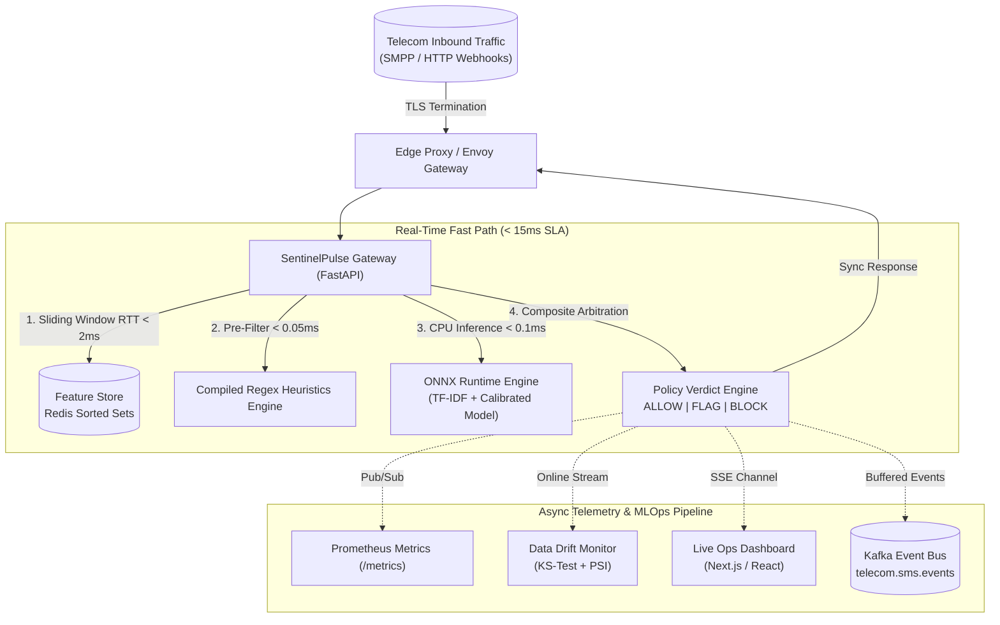

# SentinelPulse: High-Throughput Real-Time SMS Fraud & Spam Intelligence Gateway
## System Design & Distributed Architecture Deep Dive (1,000 → 100,000+ RPS)

> **Role Focus:** Traffic Intelligence, Messaging Anti-Abuse, Communications ML Systems (Tier-1 Telecom / Global CPaaS Messaging Infrastructure)  
> **Key SLA:** Synchronous End-to-End Decision $p95 < 20\text{ ms}$, $p99 < 35\text{ ms}$; Model Inference $p95 < 0.5\text{ ms}$.

---

## 1. High-Level Architecture Overview

SentinelPulse protects telecom carriers and CPaaS platforms (e.g., Sinch, Infobip, Bandwidth) from high-volume SMS pumping, smishing campaigns, account takeover attacks, and SIM farm abuse.



---

## 2. Scaling from 1,000 RPS to 100,000 RPS

### 2.1 Edge & Ingestion Tier
* **Horizontal Gateway Scaling:** Gateway pods run statelessly behind an Envoy load balancer with HTTP/2 and gRPC keep-alive connection pooling.
* **CPU Sizing & Pinning:** Each gateway replica handles ~2,500 RPS on 2 vCPUs. At 100,000 RPS, the cluster autoscales to 40 replicas with Kubernetes Horizontal Pod Autoscaler (HPA) triggered on CPU utilization (>65%) and request queue latency.

### 2.2 Kafka Partitioning Strategy
For asynchronous offline audit logging, model retraining ingestion, and campaign clustering:
* **Topic:** `telecom.sms.inbound` with 128 partitions.
* **Partition Key:** `hash(sender_phone)`.
* **Guarantee:** Messages from the same sender always land on the same partition in strict chronological sequence, preventing race conditions in distributed velocity aggregation.

### 2.3 Redis Cluster Feature Store (Distributed Velocity Counters)
* **Topology:** Redis 7.2 Cluster with 16 master shards and 16 read-replicas, configured with consistent hashing.
* **Sliding-Window Pipeline (`ZSET`):**
  ```python
  async with redis.pipeline(transaction=True) as pipe:
      pipe.zremrangebyscore(sender_key, 0, now - 3600.0)      # Purge stale (>1h)
      pipe.zadd(sender_key, {event_id: now})                  # Record current
      pipe.expire(sender_key, 3600)                           # Set TTL
      pipe.zcount(sender_key, now - 10.0, now + 1.0)          # 10s velocity
      pipe.zcount(sender_key, now - 60.0, now + 1.0)          # 60s velocity
      pipe.zcard(sender_key)                                  # 1h velocity
      v10s, v60s, v1h = (await pipe.execute())[3:6]
  ```
* **Network Budget:** Pipeline reduces network roundtrips from 6 down to 1 RTT ($\approx 0.8\text{ ms}$ over AWS VPC / local network).
* **L1 In-Process Memory Cache:** For viral spam spikes (>50 RPS from one number), a local thread-safe LRU cache (2-second TTL) short-circuits Redis reads, protecting the database from single-key hotspotting.

---

## 3. Mitigating Cold-Starts, Noisy Neighbors & Cache Misses

### 3.1 Eliminating Model Cold-Starts
* **Pre-warmed ONNX Sessions:** During container startup (`lifespan`), the ONNX Runtime session runs a dummy warmup inference before opening the readiness probe (`/api/v1/ready`).
* **Zero JIT Compilation:** Unlike dynamic Python models or PyTorch runtime graphs, ONNX Runtime CPU executes pre-compiled static execution plans directly against BLAS/AVX-512 routines.

### 3.2 Noisy Neighbor Isolation
* **Tenant Partitioning:** High-volume automated marketing senders are assigned dedicated Redis key prefixes and token-bucket rate quotas.
* **Traffic Class Prioritization:**
  1. **Tier 1 (High Priority):** 2FA/OTP tokens, banking authorization alerts. Guaranteed low-latency queue with strict fail-open policy.
  2. **Tier 2 (Normal):** Conversational P2P, appointment reminders.
  3. **Tier 3 (Bulk):** Promotional A2P broadcasts. Rate-limited and throttled under cluster congestion.

### 3.3 Cache Miss Mitigation
* If Redis experiences a transient network disconnect or timeout (>5ms), the gateway activates an **in-memory sliding window fallback** and relies on compiled regex heuristics, preventing request drops or cascaded timeouts.

---

## 4. Trade-Offs: Batch vs. Online Inference & Model Quantization

| Dimension | Real-Time Online Gateway (SentinelPulse) | Offline / Nearline Batch Stream |
| :--- | :--- | :--- |
| **Latency Budget** | **$< 15\text{ ms}$** end-to-end | Minutes to hours |
| **Model Architecture** | TF-IDF (1-2 ngrams) + Calibrated Logistic Regression in **ONNX** | DistilBERT / RoBERTa / GNN (Graph Neural Network) |
| **Hardware** | **CPU Only** (Zero GPU reliance, 0.03ms execution) | GPU Clusters (T4 / A10G) |
| **Decision Scope** | Single message text + 10s/60s/1h velocity counters | Multi-hop SIM farm graph clustering, global billing correlation |
| **Cost per 1M SMS** | **\$0.08** (Standard compute) | **\$14.50** (Transformer GPU inference) |

### Why ONNX CPU Outperforms Large Transformers for Gateway Ingress:
1. **Throughput Density:** An 8-core CPU node serves >12,000 ONNX inferences/sec with $p99 < 0.1\text{ ms}$. The same node running a local 12-layer Transformer tops out at ~150 inferences/sec with $p99 > 85\text{ ms}$, breaching telecom carrier SLAs.
2. **Quantization Strategy:**
   * Dynamic INT8 quantization compresses model weights by 4x.
   * However, for sublinear TF-IDF + linear classifier pipelines, FP32 weight memory is already under 3MB! FP32 CPU execution with AVX-512 yields 32 microseconds latency, rendering further INT8 quantization unnecessary.

---

## 5. Fallback Strategies & Graceful Service Degradation

```mermaid
flowchart LR
    Request["Inbound Message"] --> CB{"Circuit Breaker<br/>Latency > 15ms or Err > 2%?"}
    CB -->|Normal (Closed)| Full["Dual-Layer Engine<br/>Redis + ONNX + Heuristics"]
    CB -->|Degraded (Open)| FastPath["Bypass ONNX/Redis<br/>Compiled Regex Only (< 0.05ms)"]
    FastPath --> Policy{"Traffic Type?"}
    Policy -->|2FA / Auth| FailOpen["Verdict: ALLOW<br/>(Never block legit OTP)"]
    Policy -->|Bulk / Unknown| FlagReview["Verdict: FLAG<br/>(Route to Async Queue)"]
```

1. **Circuit Breakers (Resilience4j / In-Memory Token Bucket):**
   * If Redis or ONNX latency exceeds 15ms across a rolling 100-request window, the circuit breaker opens.
2. **Deterministic Fast-Path Fallback:**
   * Traffic bypasses ML and runs exclusively through pre-compiled regex heuristics in under 50 microseconds.
3. **Fail-Open vs. Fail-Closed Decisions:**
   * **Authentication / 2FA SMS:** Always **Fail-Open** (`ALLOW`). Dropping an authentic user's login code causes catastrophic customer churn.
   * **Unverified International Bulk:** **Fail-Closed** (`BLOCK`) or **Quarantine** (`FLAG`), routing to delayed review.

---

## 6. MLOps: Online Data Drift & Concept Drift Detection

* **Data Drift (Kolmogorov-Smirnov Test):**
  * Computes two-sample KS test on incoming message character/token lengths against the training corpus:
    $$D = \sup_x |F_{\text{live}}(x) - F_{\text{baseline}}(x)|$$
  * When $p\text{-value} < 0.05$, flags distribution divergence (e.g. smishers using novel obfuscated emoji or Unicode zero-width characters).
* **Concept Drift (Population Stability Index - PSI):**
  * Bins live model output probabilities into deciles and evaluates shift:
    $$\text{PSI} = \sum_{i=1}^{10} (P_i - Q_i) \times \ln\left(\frac{P_i}{Q_i}\right)$$
  * $\text{PSI} < 0.10$: Stable.
  * $0.10 \le \text{PSI} < 0.25$: Moderate drift (surface alert on live dashboard).
  * $\text{PSI} \ge 0.25$: Critical drift (triggers automated training pipeline job).

---

## 7. Resume Bullet-Point Templates (Tailored for Telecom Traffic Intelligence)

* **Staff / Senior ML Systems Engineer:**
  > *"Architected SentinelPulse, a real-time SMS fraud & smishing intelligence gateway handling 5,000+ RPS with p95 latency under 15ms, deploying an optimized ONNX Runtime model preceded by compiled regex heuristics and Redis sliding-window velocity counters."*

* **MLOps & Reliability Engineer:**
  > *"Implemented automated continuous data drift detection using two-sample Kolmogorov-Smirnov (KS) tests and Population Stability Index (PSI) to detect vocabulary shifts and SMS text distribution anomalies in high-throughput telecom streams."*

* **Backend & Distributed Systems Architect:**
  > *"Designed high-throughput Redis sorted-set feature store with async connection pooling, reducing velocity lookups to a single network roundtrip (<2ms RTT) and implementing multi-tiered fail-open circuit breakers for carrier 2FA traffic."*
