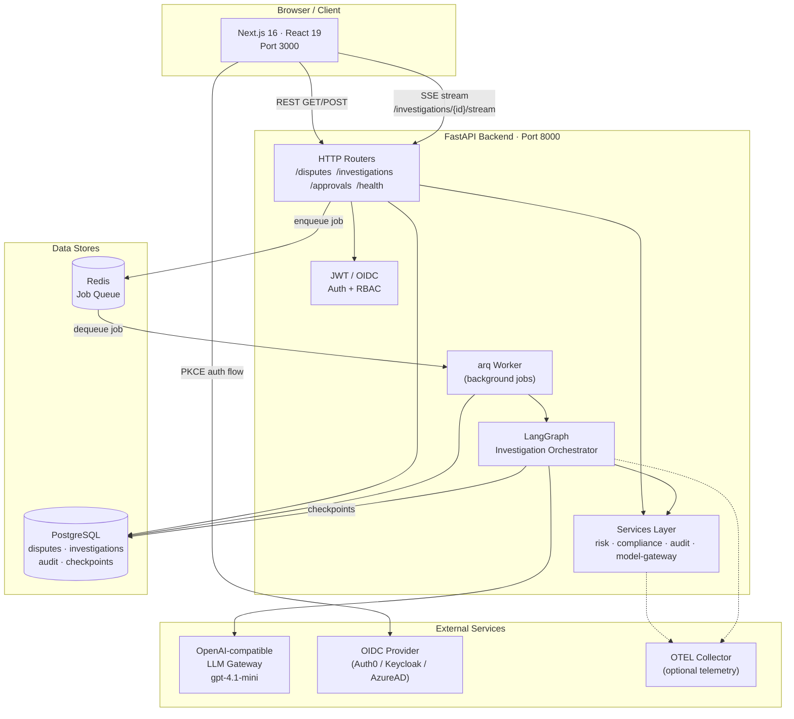
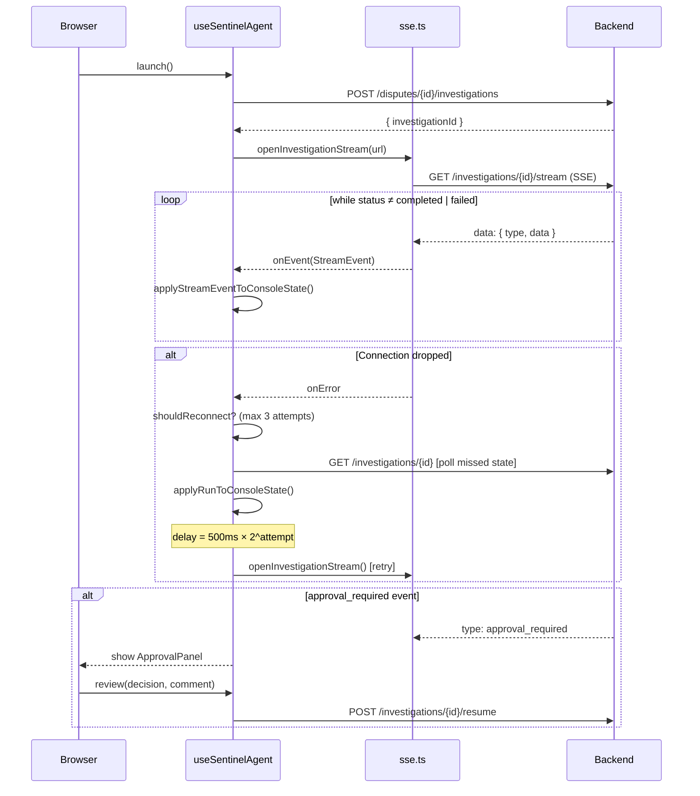
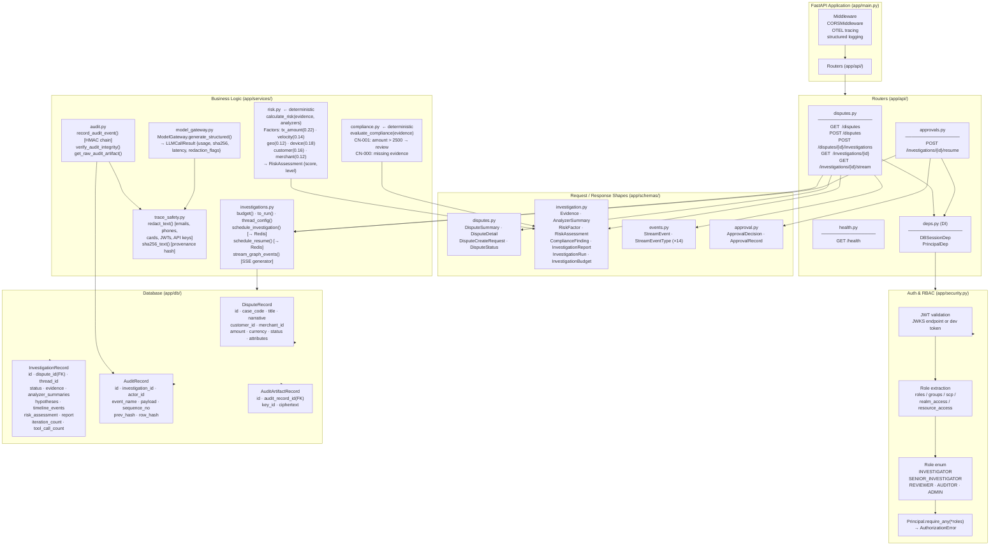
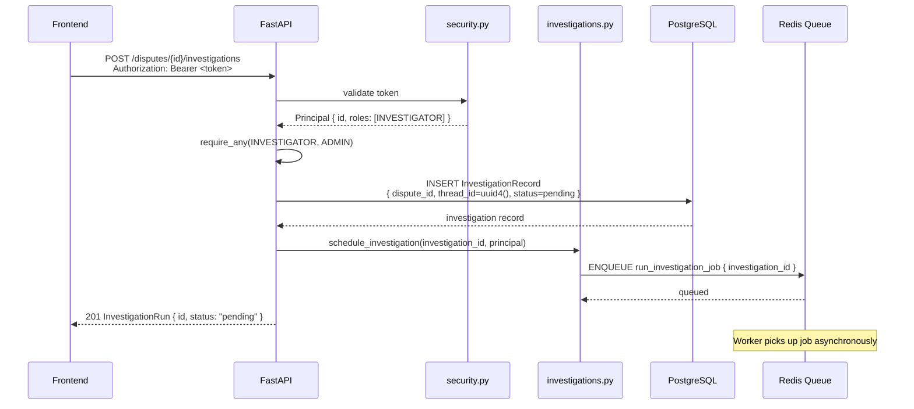
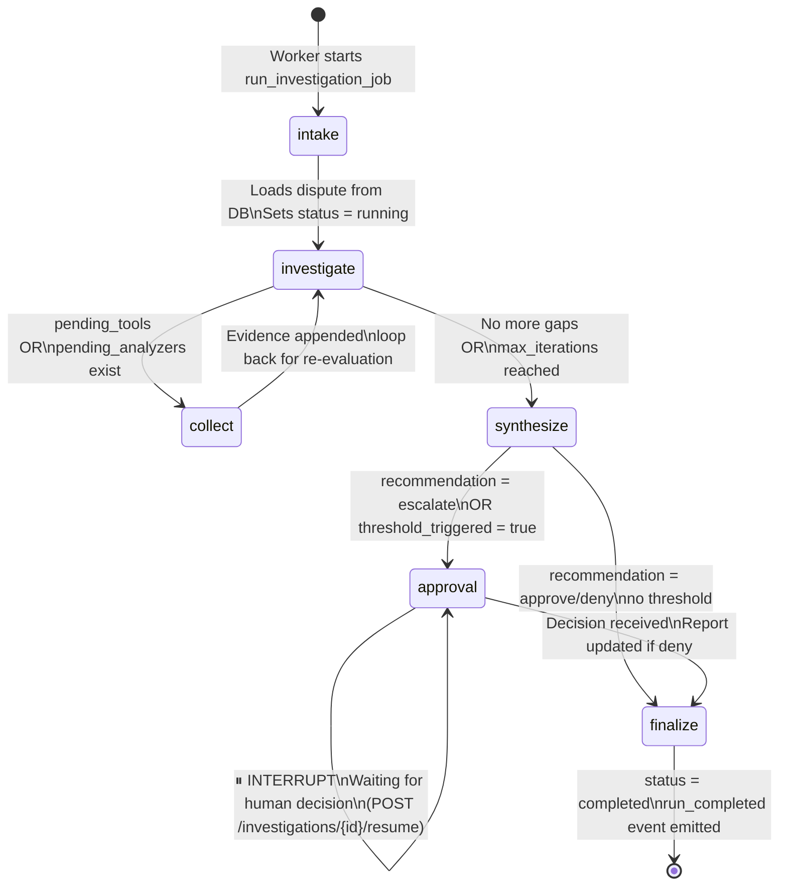
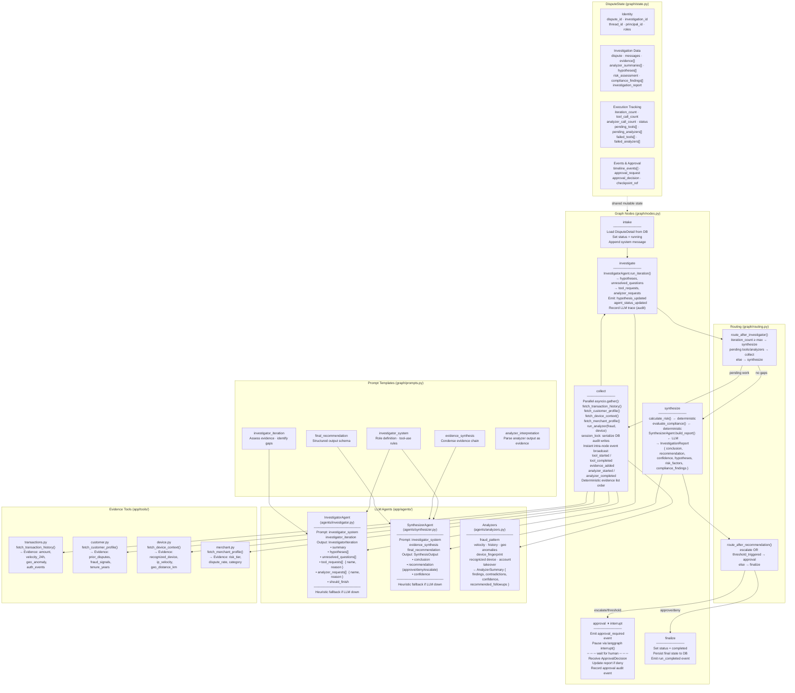
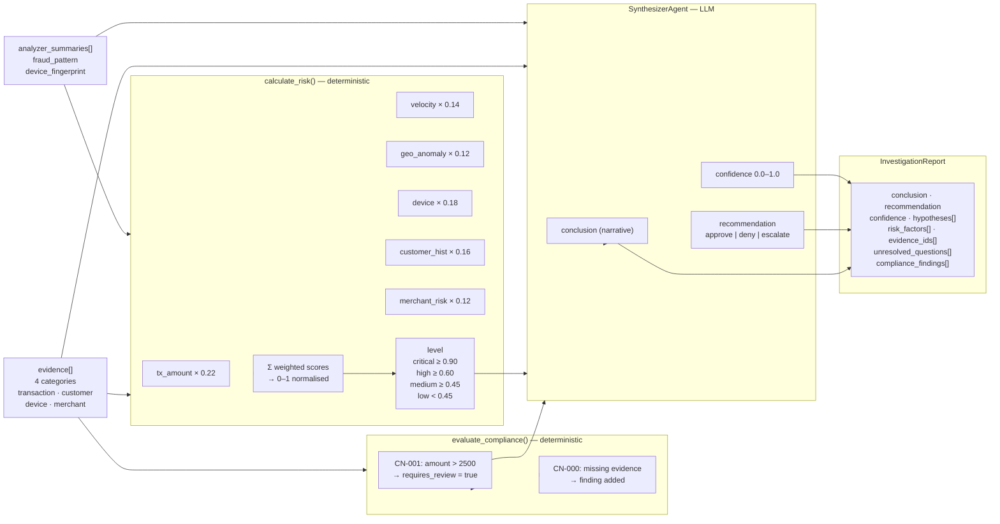
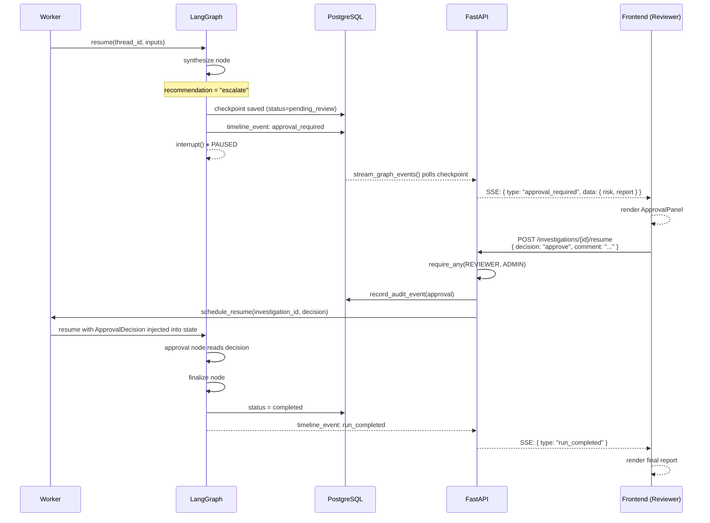
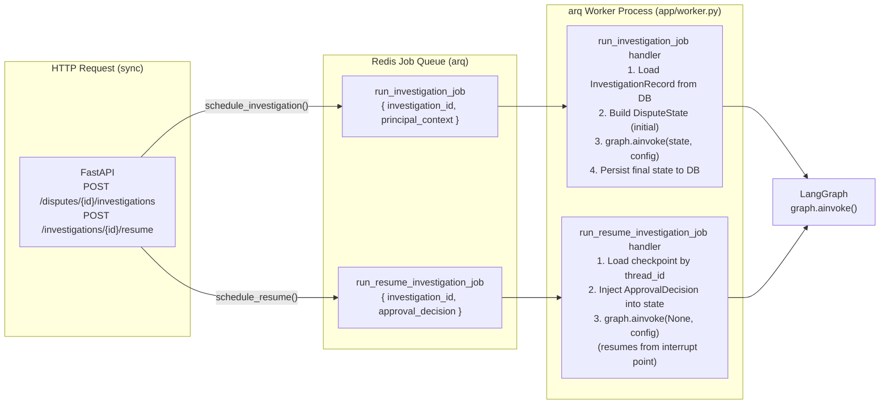

# SentinelFlow — Architecture Reference

> **Audience:** New engineers joining the team, technical interviews, system design discussions.
> Every diagram is self-contained. Read top-to-bottom for increasing detail.

---

## 1 · High-Level System Map

Shows every runtime process, the data stores they own, and the communication patterns between them.

**Communication key**

| Pattern | Where used |
|---|---|
| REST (JSON) | All FE → BE CRUD operations |
| SSE (text/event-stream) | Real-time investigation progress to the browser |
| arq job queue via Redis | Decouples HTTP response from LangGraph execution |
| LangGraph interrupt | Pause execution at `approval` node; resume after human decision |
| LangGraph Postgres checkpointer | Durable state in production; in-memory in dev |

---

## 2 · Frontend — Detailed Architecture

Shows how Next.js pages, React components, the state hook, and transport utilities relate to each other.

```mermaid
graph TB
    subgraph NEXTJS["Next.js App Router  (app/)"]
        HOME["page.tsx<br/>Dispute list home"]
        DETAIL["disputes/[disputeId]/page.tsx<br/>Investigation console entry"]
        AUTH_ROUTES["auth/<br/>login · callback · logout"]
        PROXY["app-api/<br/>Server-side API proxy"]
    end

    subgraph COMPONENTS["React Components  (components/)"]
        CONSOLE["InvestigationConsole<br/>↳ launch button, stream lifecycle,<br/>   time-travel state scrubber,<br/>   cross-panel provenance highlighting"]
        SCRUBBER["TimeTravelScrubber<br/>↳ range slider (0..N-1), step counter,<br/>   event badge, live head return,<br/>   keyboard shortcuts: [, ], L"]
        DIFF_PANEL["InvestigationDiffPanel<br/>↳ semantic iteration diffs,<br/>   confidence shifts, attribution badges"]
        REASONING["AgentReasoningPanel<br/>↳ thought process, reasoning steps,<br/>   embedded diff panel, citation pills"]
        EVIDENCE["EvidencePanel<br/>↳ category, confidence, provenance,<br/>   scrollIntoView, highlighted glow ring"]
        RISK["RiskPanel<br/>↳ score meter, level badge,<br/>   factor breakdown"]
        ANALYZER["AnalyzerPanel<br/>↳ findings, contradictions,<br/>   interactive evidence citation pills"]
        APPROVAL["ApprovalPanel<br/>↳ approve / deny buttons,<br/>   guidance input, comment textarea"]
        TIMELINE["InvestigationTimeline<br/>↳ ordered event log"]
        STRIP["AgentMessageStrip<br/>↳ current agent activity"]
        EB["ErrorBoundary"]
    end

    subgraph HOOKS["State Coordinator  (hooks/)"]
        HOOK["useSentinelAgent<br/>─────────────────────<br/>state: ConsoleState (live head)<br/>displayState: derived @ step k<br/>rawEvents: StreamEvent[] (history)<br/>selectedEventIndex: number | null<br/>iterationSnapshots[] · iterationDiffs[]<br/>─────────────────────<br/>actions: launch() · review()<br/>goToStep() · goToPreviousStep()<br/>goToNextStep() · goToLiveHead()<br/>─────────────────────<br/>SSE lifecycle & resilience:<br/>  connect → background events buffer<br/>  reconnect with exponential backoff"]
    end

    subgraph LIB["Transport + State Utilities  (lib/)"]
        API_LIB["api.ts<br/>listDisputes()<br/>startInvestigation()<br/>getInvestigation()<br/>resumeInvestigation()"]
        SSE_LIB["sse.ts<br/>openInvestigationStream()<br/>─ parses SSE chunks<br/>─ calls onEvent / onError / onClose"]
        STATE_LIB["investigationState.ts<br/>deriveConsoleStateAtStep() (&lt;0.03ms)<br/>extractIterationSnapshots()<br/>computeIterationDiff()<br/>applyStreamEventToConsoleState()<br/>applyRunToConsoleState()"]
        RECON["investigationStream.ts<br/>shouldReconnectInvestigation()<br/>streamReconnectDelayMs()"]
        OIDC_LIB["oidc.ts<br/>PKCE helpers, cookie mgmt<br/>OIDC discovery document"]
        TYPES["types.ts<br/>DisputeSummary, Evidence<br/>IterationSnapshot, IterationDiff<br/>RiskAssessment, InvestigationRun<br/>StreamEvent, ConsoleState, …"]
    end

    %% Page → Components
    HOME --> CONSOLE
    DETAIL --> CONSOLE
    CONSOLE --> SCRUBBER
    CONSOLE --> REASONING
    CONSOLE --> EVIDENCE
    CONSOLE --> RISK
    CONSOLE --> ANALYZER
    CONSOLE --> APPROVAL
    CONSOLE --> TIMELINE
    CONSOLE --> STRIP
    REASONING --> DIFF_PANEL
    EB --> CONSOLE

    %% Components → Hook
    CONSOLE --> HOOK

    %% Hook → Lib
    HOOK --> API_LIB
    HOOK --> SSE_LIB
    HOOK --> STATE_LIB
    HOOK --> RECON

    %% Auth
    AUTH_ROUTES --> OIDC_LIB
    AUTH_ROUTES --> PROXY

    %% Types used everywhere
    TYPES -. "shared interfaces" .-> HOOK
    TYPES -. "shared interfaces" .-> API_LIB
    TYPES -. "shared interfaces" .-> STATE_LIB
```

### SSE Reconnect Flow

---

## 3 · Backend — API & Services Layer

Shows the FastAPI application stack: routers, security middleware, service modules, database models, and schemas.

### Request Lifecycle — Start Investigation

---

## 4 · Backend — LangGraph Investigation Pipeline

Shows the stateful graph, every node's responsibility, routing decisions, agents, tools, and how human approval interrupts execution.

### 4a · Graph Overview

### 4b · Detailed Node Map

### 4c · Evidence & Risk Pipeline (data flow through synthesize)

### 4d · Human Approval Flow

---

## 5 · Worker & Queue

---

## 6 · Key Design Decisions

| Decision | Rationale |
|---|---|
| **Deterministic risk + compliance** | Risk scores and compliance findings use pure functions (`services/risk.py`, `services/compliance.py`), not LLM judgment. Auditable, reproducible, testable. |
| **LLM only for reasoning gaps** | The investigator and synthesizer agents handle analysis that requires natural language understanding. Evidence gathering uses deterministic tools. |
| **Interrupt-based human approval** | LangGraph's `interrupt()` pauses graph execution at a checkpoint without blocking threads. The HTTP handler resumes the graph via the worker queue. |
| **SSE over WebSocket** | Unidirectional server-push is sufficient and simpler to proxy/load-balance. Reconnect with state poll covers dropped connections. |
| **HMAC audit chain** | Every audit event includes `prev_hash + row_hash` (HMAC-SHA256). Tampering breaks the chain and is detectable via `verify_audit_integrity()`. |
| **arq worker decoupling** | Investigations can take minutes. The HTTP layer returns immediately after enqueueing. The worker handles all long-running graph execution. |
| **Dev token fallback** | Hardcoded dev tokens (`dev-investigator`, `dev-reviewer`, etc.) allow local development without an OIDC provider. Disabled by env flag in production. |
| **Client-Side Time-Travel State Scrubber** | Investigators can scrub backward through arbitrary historical events (`0..N-1`) via `deriveConsoleStateAtStep()` in `<0.03ms`. Background incoming SSE events continue appending to `rawEvents` without jumping or dropping state. |
| **Iteration & Revision Diff Inspector** | Evaluates semantic state shifts between iterations (`IterationSnapshot` & `computeIterationDiff`) with clear attribution badges (`[AI Investigator]`, `[Human Reviewer Steering]`, `[Deterministic Engine]`), confidence deltas, and risk score tracking. |
| **Cross-Panel Evidence Provenance Highlighting** | Clicking evidence citations in `AnalyzerPanel` or `AgentReasoningPanel` highlights evidence cards in `EvidencePanel` with a 2px accent ring, glow shadow, and smooth `scrollIntoView`. |
| **Parallel Tool Execution with Session Locking** | Independent evidence gathering tools and analyzers execute concurrently inside `collect` using `asyncio.gather(*tasks, return_exceptions=True)`. Access to `self.session` for cryptographic audit records is serialized via `session_lock = asyncio.Lock()`, eliminating connection state collisions while slashing node duration from ~4s to ~1s. |
| **Granular Intra-Node Streaming** | `tool_started`, `tool_completed`, `evidence_added`, `analyzer_started`, and `analyzer_completed` events publish immediately to Redis Pub/Sub as each tool/analyzer runs, providing live sub-second updates instead of batching until node exit. |
| **Deterministic Verification Gates** | Production readiness verified via **104 backend tests** (`pytest`, 86% coverage floor) and **28 frontend tests** (`node --experimental-strip-types --test`, sub-millisecond replay benchmarks). |
