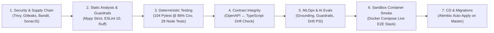

# Pipeline & Architecture Overview

An evolving technical reference detailing SentinelFlow and SentinelPulse's continuous integration, automated verification gates, and architectural patterns.

---

## 7-Stage Pipeline Matrix

---

### 1. Security & Supply-Chain Gate
- **Secret Scanning**: `gitleaks` analyzes full git commit history and staged changes to prevent accidental credential leakage ([CWE-798](https://cwe.mitre.org/data/definitions/798.html)).
- **Container & Filesystem SAST/SCA**: Aqua Security's `trivy` scans filesystem configurations, Dockerfiles, and package manifests for critical/high vulnerabilities and misconfigurations.
- **Dependency Auditing**: 
  - Backend: `pip-audit --skip-editable` queries PyPI advisory feeds.
  - Frontend: `pnpm audit --audit-level=high` validates the Node.js dependency graph.
- **Automated Compliance Suite**: [`security_compliance_scan.py`](ops/security_compliance_scan.py) automatically checks and scores 11/11 controls covering OWASP Top 10, LLM Top 10, CWE-78, CWE-89, CWE-259, CWE-327, CWE-284, CWE-312, CWE-841, CWE-16, CWE-287, and CWE-353.
- **Artifacts**: Machine-readable JSON compliance scorecards are preserved in CI via GitHub Actions artifacts (`owasp-security-compliance-report`).

---

### 2. Static Analysis & Architectural Guardrail Linters
- **Python Quality & Types**:
  - `ruff check app` and `ruff format --check app` enforce style guidelines and Bandit security AST rules (`--select S`).
  - `bandit -c pyproject.toml -x app/tests -r app -q` executes deep abstract syntax tree security analysis.
  - `mypy app` performs strict static type checking across 73 backend source files.
- **TypeScript & Frontend Quality**:
  - ESLint 10 coupled with `eslint-plugin-sonarjs` inspects cognitive complexity and JavaScript/TypeScript security hotspots.
  - `prettier --check .` verifies deterministic code formatting.
- **Enforced Workspace Guardrails**:
  - Custom AST policy scanner [`check-rules.js`](frontend/scripts/check-rules.js) guarantees 100% arrow function adoption and complete `try/catch` block handling (banning unhandled `.then()` / `.catch()` promise chains).
- **Semantic CodeQL**: Deep semantic code analysis is automated via [`.github/workflows/codeql.yml`](../.github/workflows/codeql.yml).

---

### 3. Test Coverage & Deterministic Verification
- **Backend Test Suite**:
  - **104 tests** execute in ~22 seconds via `pytest`.
  - **Coverage Floor**: Integrated `pytest-cov` strictly enforces a **minimum 80% coverage threshold** (`--cov-fail-under=80`). Current measured codebase coverage is **86% across 4,949 statements**.
  - Covers API contracts, state graph node transitions, parallel tool execution with session locking, human-in-the-loop approvals, ONNX inference bounds, velocity counters, and cryptographic ledger hash-chains.
- **Frontend Test Suite**:
  - **28 unit tests** run in native Node.js (`node --experimental-strip-types --test`) in under 300ms.
  - Validates authentication routes, PKCE challenge generation, state reducers, SSE chunk parsing, reconnection backoff, deterministic time-travel state reconstruction (`deriveConsoleStateAtStep` benchmark: 100 derivations in <2.8ms), iteration diff computation, selector isolation, and stream lifecycle cleanup.
- **End-to-End & Visual Regression**:
  - Headless Chromium tests via Playwright ([`app.spec.ts`](frontend/e2e/app.spec.ts)) verify unauthenticated redirect gates, login flows, and visual pixel diff snapshots (`maxDiffPixelRatio: 0.1`).

---

### 4. API Contract Drift Prevention
- **The Problem**: Disconnects between backend API responses and frontend TypeScript models frequently cause silent runtime bugs in production.
- **Deterministic Synchronization**:
  - Backend serializes its schema to [`backend/openapi.json`](backend/openapi.json).
  - The frontend runs [`scripts/generate-types.js`](frontend/scripts/generate-types.js) to generate strict TypeScript models in [`frontend/lib/types/api.generated.ts`](frontend/lib/types/api.generated.ts).
  - CI runs `git diff --exit-code`. If any API contract changes without updating the generated client types, the build fails immediately.

---

### 5. AI Eval-Driven Development (EDD) Gate
- **Evaluation Harness**: [`app.evals.run`](backend/app/evals/run.py) evaluates a representative benchmark dataset on every pull request.
- **Target Metrics**:
  - **Recommendation Accuracy**: $\ge 90.0\%$
  - **Evidence Groundedness**: $\ge 90.0\%$
  - **Safety Guardrail Pass Rate**: $100.0\%$ (verifying pre-execution prompt injection defense and post-execution hallucination checks).
- **MLOps Real-Time Drift Telemetry**:
  - Background monitor evaluates incoming production traffic using Kolmogorov-Smirnov ($p$-value on message lengths) and Population Stability Index (PSI on fraud score distributions) against the training baseline.
  - Automatically exported to Prometheus gauges (`telecom_drift_psi`, `telecom_drift_ks_pvalue`, `telecom_drift_status`).

---

### 6. Ephemeral Sandbox Container Smoke Gate
- **Container Integration**: Unit tests run against mocks or local SQLite; this gate validates the actual Docker containers.
- **Execution Flow** in `.github/workflows/ci.yml`:
  1. Executes `docker compose -f sentinelflow/docker-compose.yml up -d --build --wait` to spin up PostgreSQL 16, Redis 7, Backend, Frontend, Nginx, and Jaeger.
  2. Executes database migrations via `backend-init` container.
  3. Probes reverse proxy and readiness endpoints: `http://localhost:8080/healthz` and `/api/v1/ready`.
  4. Dispatches a live transaction to `POST http://localhost:8080/v1/classify`, validating the ONNX CPU inference engine and Redis velocity store end-to-end through Nginx.
  5. Executes an ephemeral load smoke run via the traffic simulator container (`--profile simulator`).
  6. Tears down the ephemeral stack and purges volumes (`docker compose down -v`).

---

### 7. Automated PR Scorecard (`GITHUB_STEP_SUMMARY`)
- Pull request runs write rich Markdown scorecards directly into the GitHub Actions run summary:
  - **Security Matrix**: Detailed status of each OWASP control, bandit findings, and CVE scan results.
  - **AI Evals Scorecard**: Pass/fail table comparing measured accuracy, groundedness, and safety metrics against target SLAs.

---

## Questions

| Topic | Question | Architectural Implementation |
| :--- | :--- | :--- |
| **Micro-Benchmark / Latency Budget** | *How is a latency regression prevented from breaching the 15ms p95 SLA?* | The CI pipeline runs live transactions and a containerized simulator smoke test. In addition, unit tests in `test_telecom_gateway.py` assert `latency_ms < 25.0` on every run. At higher volume, this executes against a dedicated runner to isolate CPU jitter. |
| **Progressive Canary Deployments** | *How are zero-downtime rollouts handled without dropping live SSE streams?* | The Nginx reverse proxy disables buffering (`X-Accel-Buffering: no`), and active investigation stream events are bridged through Redis Pub/Sub, allowing backend instances to restart or roll over without losing state. |
| **Branch / Ephemeral Previews** | *How are feature branches tested prior to merging?* | The entire stack is containerized and defined in `docker-compose.yml` and `render.yaml`, allowing automated per-PR preview environments to spin up and tear down cleanly. |
